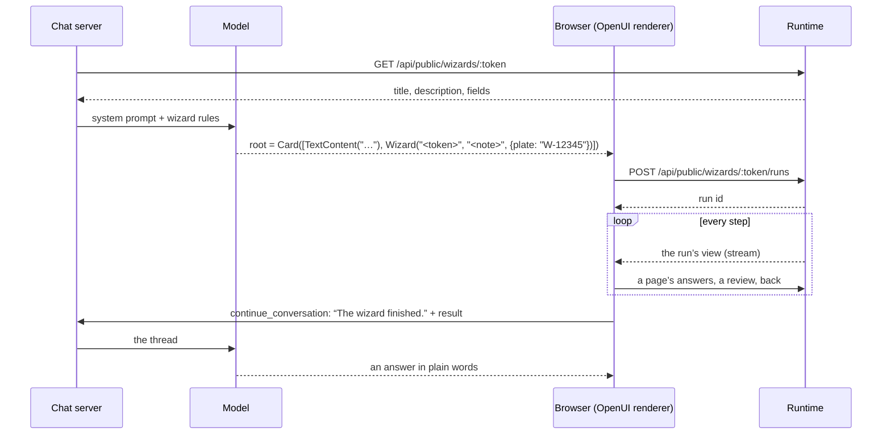

A chat built with [OpenUI](https://github.com/thesysdev/openui) composes its answers as it
goes: cards, charts, forms and buttons, whatever the model finds fitting. A wizard is the one
thing in such a chat that runs the same way every time, with the pages, steps and result its
author defined. `@engenty/wizards/openui` puts the two together: the chat decides that a wizard
fits and what it already knows, the wizard then runs inside the conversation, and the chat
hears the result.

It is part of `@engenty/wizards`, the package for code outside engenty wizards
([`packages/wizards/src/openui`](https://github.com/engenty/wizards/tree/main/packages/wizards/src/openui)
in the repository, under the MIT licence). A whole chat to try it with is `examples/openui-chat`.

## What OpenUI is

OpenUI (Thesys, MIT) is a way to let a model draw. Three parts matter here:

- **A language the model writes.** An answer is a short program: `root = Card([…])` with
  components as calls, such as `TextContent("…")` or `Form(…)`. The model streams it like text.
- **A React renderer** (`@openuidev/react-lang`) that parses the program as it streams and draws
  it with a **component library**: React components with a name, a description and typed props.
- **A chat kit** (`@openuidev/react-ui`): the library of chat components, the thread, the
  composer and an `AgentInterface` that puts them together.

The model learns the language from the system prompt the library makes. The chat library’s
prompt is about 14,000 tokens: every component with its props and description, the rules, and
5 worked examples of whole answers. The model imitates the examples. Nothing in that prompt is
a fixed flow: every answer, and every form in it, is composed anew.

A wizard is the only fixed definition in such a chat. The model writes one line, and from then
on the wizard’s pages, AI steps, review and result run as its author defined them.

## How the Wizard component works



It has two halves, one for each side of the chat.

### The server half

`@engenty/wizards/openui/server` draws nothing, so a server can import it alone.

```ts
import { addWizard, loadWizards, wizardRules } from "@engenty/wizards/openui/server";
import { openuiChatLibrary, openuiChatPromptOptions } from "@openuidev/react-ui/genui-lib";

const wizards = await loadWizards("http://localhost:24368", ["<token>", "<token>"]);
const prompt = addWizard(openuiChatLibrary).prompt({
  ...openuiChatPromptOptions,
  additionalRules: [...(openuiChatPromptOptions.additionalRules ?? []), ...wizardRules(wizards)],
});
```

- `loadWizards(runtimeUrl, tokens)` reads each published wizard from the runtime
  (`GET /api/public/wizards/:token`): its title, description and the fields its pages ask, in
  order. A wizard the runtime does not answer for is left out, so the chat keeps working when
  one is unpublished.
- `addWizard(library)` extends an OpenUI library with the Wizard component, among a Card’s
  children. Its prompt then has `Wizard(wizard: string, note?: string, prefill?: …)`.
- `wizardRules(wizards)` are the rules that go with it: when to answer with a wizard, that the
  wizard asks its own questions (never a Form in its place), what may be prefilled, and the list
  of wizards with their tokens and fields.

With that, the model answers a fitting request with a Card that holds one short text and
`Wizard("<token>", "<note>", {prefill})`. The prefill holds answers the person already gave in
the conversation, by field id; the person still sees and sends each page.

### The component, in the browser

```tsx
import "@engenty/wizards/openui/styles.css";
import { addWizard, configureWizards, Wizard } from "@engenty/wizards/openui";
import { openuiChatLibrary } from "@openuidev/react-ui/genui-lib";

configureWizards({ runtime: "/wizards-runtime" });
const library = addWizard(openuiChatLibrary, Wizard);
```

- `configureWizards({ runtime })` names the runtime once, as the browser reaches it: a path the
  host proxies to it, or the runtime’s address. A proxy on the host’s own address keeps the
  runner’s visitor cookie first-party. `lang` sets the language of the runner’s own words
  (`en` unless given), `Mascot` draws the wizard’s mascot above its pages.
- `addWizard(library, Wizard)` is the same extension as on the server, with the drawing
  component. Both make the same prompt.

The component draws the run with the runner, the same code as the wizard’s own page
(`packages/runner`), in styles scoped to `.engenty-runner`, so the chat’s styles and the
runner’s never meet. Every field kind works as on the wizard’s own page, the camera and the
signature included. The page is not a frame, so nothing else is needed for them.

What happens in the message:

1. **The run starts** once the model’s line has finished streaming, so a half-written token never
   starts a run: `POST /api/public/wizards/:token/runs`, as a visitor of the runtime.
2. **The run id stays with the message**, in the state OpenUI keeps for it. A message shown again
   continues the same run.
3. **The run shows live** over the runtime’s stream of the run’s view (`/api/runs/:id/stream`), and
   the person’s answers go to the run’s routes (`/api/runs/:id/pages/:step`, `…/reviews/:step`,
   `…/back`, `…/retry`). These are the routes the wizard’s own page uses.
4. **The result goes back to the chat.** When the component sees the run finish, it sends OpenUI’s
   `continue_conversation` action: a turn of the person that says the wizard finished, with the
   result as context for the model: the wizard’s title, the run id and the texts of the result
   steps, each cut at 4,000 characters. The model answers in plain words.

The chat hears of a run it saw finish. A message shown again with a done run shows the result
and tells the chat nothing new.

### Who runs, who pays

The browser talks to the runtime as a visitor, as on the wizard’s own page: the runtime sets a
visitor cookie, lets a visitor start 6 runs an hour
([`LIMIT_VISITOR_RUNS_PER_HOUR`](../../user/command-line.md#settings)) and spends the wizard’s own
credits or model keys. The chat’s model and the wizards’ model are two different things: the
chat picks the model that writes its answers, and each wizard’s steps run on what its space
has.

## Try it

`examples/openui-chat` is an OpenUI chat (`AgentInterface`) with any OpenAI-compatible model,
the wizards it may start and a proxy to the runtime. In short:

1. Start the runtime from a checkout (`pnpm dev`) and publish a wizard or two in the studio.
   Each one’s token is the part of its link after `/w/`.
2. Put an `.env.local` in `examples/openui-chat`: `WIZARDS=<token>,<token>`, `CHAT_BASE_URL`,
   `CHAT_API_KEY` and `CHAT_MODEL` for the chat’s model.
3. `pnpm --filter @engenty-wizards/example-openui-chat dev` and open `http://localhost:5190`.
4. Ask for something a wizard does, in your own words.

The example’s README has the details, the endpoints that work and what to set while you try
things.

## Exports

| From | Export | What it is |
|---|---|---|
| `@engenty/wizards/openui/server` | `loadWizards(runtimeUrl, tokens)` | The published wizards behind the tokens, as `WizardInfo[]` |
| | `wizardRules(wizards)` | The rules a system prompt adds |
| | `addWizard(library, component?)` | The library with the Wizard component among a Card’s children |
| | `WizardSpec`, `wizardProps`, `WizardProps` | The component as a prompt sees it, and its props |
| | `WIZARD_COMPONENT`, `WIZARD_DESCRIPTION` | Its name and description |
| `@engenty/wizards/openui` | all of the above | |
| | `configureWizards(config)` | Names the runtime, the language and the mascot |
| | `Wizard` | The drawing component |
| | `useWizardRun(runId, prefill)` | One run, live, for a host that draws runs itself |
| `@engenty/wizards/openui/styles.css` | | The runner’s styles, scoped to the wizard |

`@openuidev/react-lang`, `react`, `react-dom` and `zod` are peer dependencies: the chat brings
them. The package is written against `@openuidev/react-lang` 1.0 and the chat kit
`@openuidev/react-ui` 0.18.

## Good to know

- **One runtime per page.** `configureWizards` names it once, before the first render.
- **Other hosts.** The component sits on the runtime’s public run routes, not on OpenUI’s
  internals. A host with its own components can draw a run with `useWizardRun` and the runner’s
  parts, and another UI format can follow the same way.
- **OpenUI’s Inspect button** at the bottom right of a page in development is OpenUI’s own
  (`@openuidev/react-lang` adds it and loads it from jsDelivr). A production build leaves it out.
