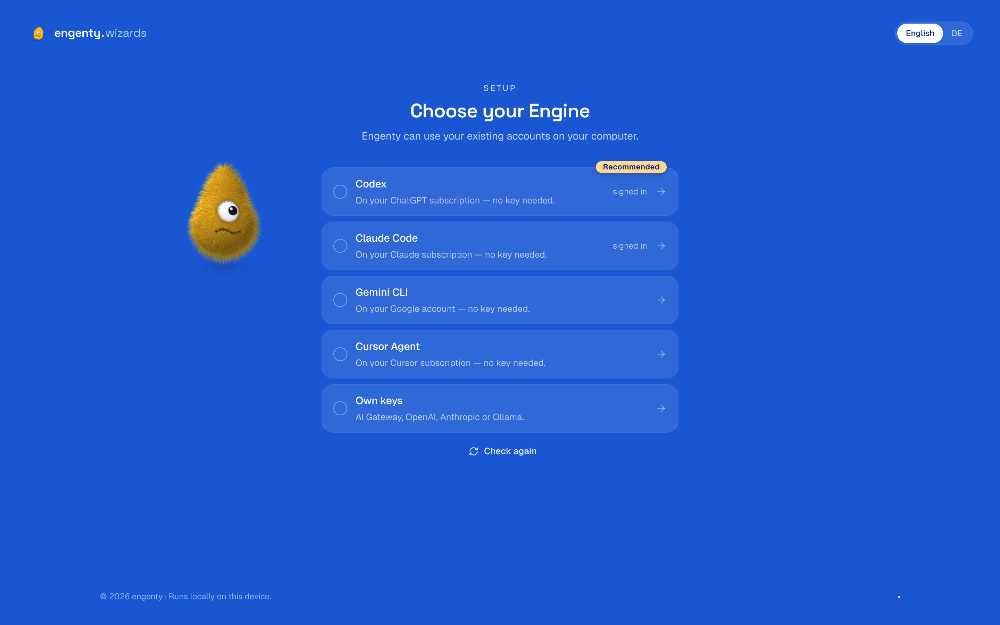

The first page of the studio is the setup, "Choose your Engine". It asks one thing: what should
engenty think with?

## Your account

Above the engines stands your account: signed in during the [install](./install.md), it shows
your name, your team and your credits, and your team's space is on this computer. Not signed in
yet, "Sign in" opens your browser for it; an install that is [local only](./local-only.md)
shows nothing here.

## Choose your engine

| Engine | Runs on | Needs |
|---|---|---|
| engenty credits | Your account's credits, like in the cloud | An account signed in. Shown only then |
| Claude Code | Your Claude subscription | The client installed and signed in |
| Codex | Your ChatGPT subscription | The client installed and signed in |
| Gemini CLI | Your Google account | The client installed and signed in |
| Cursor Agent | Your Cursor subscription | The client installed and signed in |
| Apple Intelligence | The model on this Mac, without an account or the internet | A Mac with Apple silicon on macOS 26 or later, Apple Intelligence switched on. Shown only on such a Mac |
| Own keys | Vercel AI Gateway, OpenAI or Anthropic, or a model on your computer | One API key, or [Ollama](https://ollama.com) running |

- **An AI client that is not installed** installs right on the page, in a terminal shown there.
  It takes about a minute.
- **Signing in** happens in the same terminal, with the client's own sign-in: your browser opens
  for it, and the terminal closes once the sign-in is there.
- **A client signed in with an API key from your shell** is not on your subscription. Sign in on
  the page so it is.
- **Apple Intelligence** has nothing to connect: the test runs once it is switched on (System
  Settings → Apple Intelligence & Siri). It thinks short texts and decisions; research, long
  documents and code stay with a client you picked before it, or need another way, added later
  under Settings → Models. See [Apple Intelligence](./models.md#apple-intelligence).

## The test

After you connect, one short call shows whether the way to the model is open. The setup stays
until that call works; then "Open the studio" takes you in.

## What an AI client does not cover

An installed AI client writes and reasons. Codex also makes images on your sign-in; with the
other clients images need a key. Video and audio need a key with every client, or the credits of
an engenty account; a Mac with Apple silicon on macOS 26 can write voice notes down itself. One
Vercel AI Gateway key serves text, images, video and web search. You can add it later under
[Models and account](./models.md).

## Change it later

Settings → Models. See [Models and account](./models.md).
