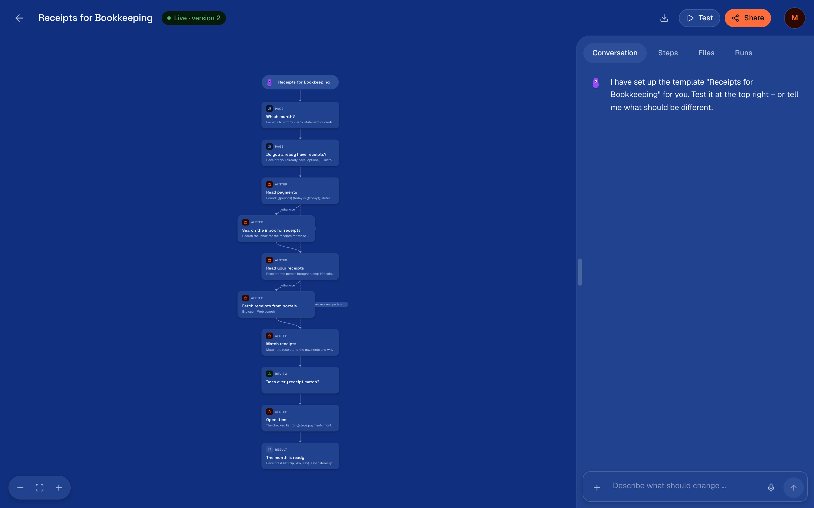

engenty wizards turns something you do again and again into a wizard: pages that ask what it
needs, AI steps that do the work, and a link to share. A post with an image, a research
briefing, an invoice, a quote, a damage report.

## What you do with it

| | |
|---|---|
| **Describe it** | Say in plain words what the wizard should do. The assistant builds the flow; you see it as a diagram and change any step. |
| **Let AI steps work** | They research the web, write, draw images, render video, read PDFs, scans and mails, build documents and dashboards, and write into other services. Anything that changes an account asks first. |
| **Share a link** | Anyone runs the wizard in a browser, on a phone too. Results download as PDF, Word, HTML, Markdown, PNG, MP4, MP3, CSV, Excel or JSON, or go out as a link. |
| **In the cloud, or on your computer** | Sign up and build in the browser; links run on your team's credits. Or install it on your computer: it thinks with Codex, Claude Code, Gemini CLI or Cursor Agent on your own subscription, with your own keys, or with a local model, and your files stay with you. |

## Where to start

1. [Create an account](./create-account.md) at engenty.ai, with an invitation code.
2. [Build a wizard](./build-a-wizard.md) from a sentence or a template.
3. [Test and share](./test-and-share.md) it.
4. Also on your computer: [install](./install.md) it there, signed in to the same account, and at the [first start](./first-start.md) choose what it thinks with.
5. Use it from your [AI apps](./ai-apps.md): Claude Desktop, Cursor, Codex and others.

## Words used here

| Word | Means |
|---|---|
| Account | You, signed in at engenty.ai with Google, GitHub or a link by mail |
| Team | What the sign-up creates: it holds your credits, your spaces and, on the Team plan, your colleagues |
| Space | What all your wizards know and produce: name, logo, colours, facts, documents, data, results. A team's first one is "Meine Wizards" |
| Studio | Where you build wizards: engenty.ai/studio, or `/studio` of your install |
| Wizard | A flow of steps a person walks through on a link |
| Step | One part of the flow: a page, an AI step, a review, the result |
| Run | One person going through a wizard once |
| Model class | The kind of model a step needs. Which model serves a class is a setting, not part of the wizard |

## Two places it runs

Your team, its space and your wizards live in your account. engenty.ai is the cloud: you build
there in the browser, and links run day and night on the team's credits. Your computer can join:
[install](./install.md) engenty wizards there, signed in to the same account, and it thinks with
the AI clients and keys on that machine; what you publish there runs in the cloud as well
([Test and share](./test-and-share.md#in-the-cloud)). An install without an account is
[local only](./local-only.md).
