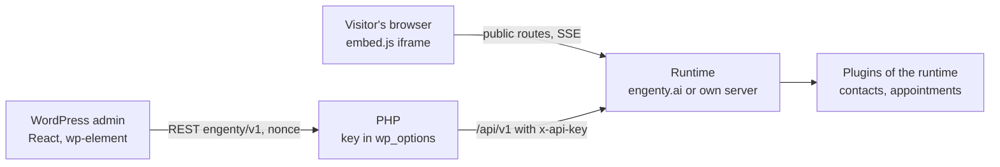

# Plan: the WordPress plugin

Status: built on 2026-10-09 (see [Built](#built) at the end; it changes some decisions below:
cloud only, sign-up and sign-in by OAuth instead of a pasted key, the site reads itself in).
Mockups (WordPress admin with the studio look inside, German UI):
https://claude.ai/artifact/8u9iU2ABq2oPo93w1o11Ti

Scope: a WordPress plugin that puts published wizards on a WordPress site (block, shortcode,
Elementor widget, PHP, a bubble on every page), lists the wizards and their results in the
WordPress admin, and shows what the Pro plugins collected there (contacts, appointments).
Building wizards stays in the studio.

## Decisions

| Question | Decision | Why |
|---|---|---|
| Can the runner run in PHP on a WordPress host? | No. The plugin is a client of a runtime | The engine is TypeScript: steps, model calls through the gateway, tools, the sandbox, SSE streams, plugins. A PHP port is a second engine. A typical host has PHP only: no Node, no long-lived process, request timeouts under a minute, no SSE |
| Which runtime? | engenty.ai by default (the account's cloud runtime); an own server ([server.md](../content/user/server.md)) as the second way; a local install only for `localhost` | The same three places the share dialog knows today |
| Studio in WordPress? | No. The admin lists, starts, embeds and reads. "Im Studio öffnen" links out | A studio in the admin is a second studio to keep in step |
| Who talks to the runtime? | Visitors: the browser, straight to the runtime through `embed.js` (iframe), as on any website. The admin: PHP, with the API key kept in `wp_options`, never in the browser | Runs need SSE, uploads, camera, Turnstile: the iframe already has them. The key must not leak into pages or the editor |
| Plugins of the runtime in WordPress? | The WordPress plugin ships a page for the plugins a website cares about: `contacts` (leads) and `appointments` (bookings). Each reads the plugin's own HTTP routes with the key. A plugin the WordPress plugin knows nothing about shows nothing | The studio half of a plugin is React built against the studio; it cannot load in the admin. A generic "any plugin's table" needs a descriptor the SDK does not have; two concrete pages are honest and small |
| License and repository | Own public repository, GPLv2 or later | WordPress.org takes only GPL-compatible plugins; the runtime's FSL license is not. Nothing of the runtime is copied: the plugin is PHP plus a small React admin |
| What WordPress stores | Settings, the key, a cached wizard list (transient, 5 minutes). No runs, no answers | Results stay where they are run; the admin reads them live. Less to protect, nothing to delete |

## What exists that the plugin builds on

| Need | Exists today | Where |
|---|---|---|
| Show a wizard on a page | `embed.js`, `data-wizard`, `data-mode="inline" \| "modal"`, `data-label`; the button takes the site's styles | `apps/web/public/embed.js`, [test-and-share.md](../content/user/test-and-share.md#embed-in-a-website) |
| The chat runner, `data-runner="chat"`, `data-mode="popout"` | On the branch `claude/wizards-vs-bot-ui-1044fe` | [runners-and-voice.md](https://github.com/engenty/engenty-wizards/blob/claude/wizards-vs-bot-ui-1044fe/docs/plans/runners-and-voice.md) § D |
| What a visitor's browser calls | `GET /api/public/wizards/:token`, `POST …/runs` (Turnstile, 6 runs an hour per visitor, 50 a day per link), `/api/runs/:id/*` | `apps/runtime/src/routes/runs.ts` |
| A key for a client | `wz_…` API keys: a local install's under Settings → Einbinden, an account's in the Manage-App. Taken as `x-api-key` or a bearer on `/api/v1` and `/api/mcp` | `apps/runtime/src/mcp/auth.ts`, [manage-contract.md](../manage-contract.md#tokens) |
| List the wizards with a key | `GET /api/v1/spaces` → spaces with `wizards: [{ id, title, publishedVersion, shareUrl, shareEnabled }]` | `apps/runtime/src/routes/api.ts` |
| A plugin's routes | `server.registerHttpRoute` below `/api/studio/plugins/<id>` (session only) | [routes.md](../content/dev/plugins/routes.md) |
| Leads, bookings | `contacts` lists people with `q`, `type`, `role`, `wizard`, pages of 50; `appointments` keeps bookings per person | `engenty-wizards-manage/plugins/{contacts,appointments}` |
| Where the plugin shows up in the studio | Settings → Einbinden lists the AI apps and, under "Teilen", the link and the website tag | `apps/web/src/studio/Integrate.tsx` |

## The plugin

Slug `engenty-wizards`, name "engenty wizards", PHP ≥ 8.1, WordPress ≥ 6.5. One repository,
`engenty/wordpress`, released as a zip on GitHub and later through WordPress.org.



### Pages of the admin

Menu "engenty" with the engenty mark, below "Kommentare".

| Page | Shows | Who |
|---|---|---|
| Wizards | The published wizards of the space: engenty, title, version, where it runs (engenty.ai, own server), link on or off, which plugin it needs. Per wizard: Starten (opens the link), Einbetten (shortcode, block hint, PHP line), Im Studio öffnen. "Neu laden" drops the cache | `edit_posts` |
| Ergebnisse | Runs of the space, newest first: wizard, when, status, the page it ran on, the person's e-mail where the wizard asked one. A row opens a drawer: the answers, the outputs with downloads, the share page | `engenty_results` (given to administrators and editors on activation) |
| Kontakte | Only when the runtime has `contacts`: the leads, search, source wizard, CSV export link. A contact opens in the studio | `engenty_results` |
| Termine | Only when the runtime has `appointments`: the next bookings, cancelled ones, per wizard | `engenty_results` |
| Einstellungen | Verbindung (address, key, "Testen", what the key sees: space, plan, plugins), Darstellung (default mode, button label, the bubble on every page and on which pages), Datenschutz (the sentence for the site's privacy statement, with the runtime's address), Zugriff (which roles see results) | `manage_options` |

Before a connection every page shows the connect screen: engenty.ai (sign in there, make a key
under Einbinden → WordPress, paste it) or an own server (address and key).

### Putting a wizard on a page

All five ways render the same tag. The plugin adds `data-source="wordpress"` and the page's
address so a run knows where it came from (`run.origin`, below).

| Way | How | For |
|---|---|---|
| Block `engenty/wizard` | Pick the wizard, the mode (Im Text, Button + Fenster, Chat, Chat-Blase), the button label. The editor shows the real wizard in an iframe | Gutenberg, the site editor |
| Shortcode | `[engenty_wizard id="TOKEN" mode="modal" label="Anfrage starten"]`; also `[engenty_wizard]` with the default of the settings | Classic editor, page builders with a shortcode widget, widgets |
| Elementor widget | "engenty Wizard" in the "Allgemein" group, the block's controls, live in the canvas | Elementor |
| PHP | `engenty_wizard( 'TOKEN', [ 'mode' => 'inline' ] )` echoes the tag | Themes, templates |
| Bubble | Settings: one wizard as a bubble bottom right on every page, or on chosen pages. A chat bubble when the chat runner is on | Support, lead capture |

`id` takes the share token or the wizard's ID (the code the mobile app takes); the plugin
resolves the code through `GET /api/public/codes/:code` once and caches it.

Modes map to `embed.js`: `inline`, `modal`, `chat` (`data-runner="chat"`, from the branch),
`bubble` (new, below).

### What the admin calls

PHP registers `engenty/v1/*` REST routes (nonce, capability) and forwards to the runtime with
`x-api-key`. The browser never sees the key or the runtime's address of the key.

| REST route | Runtime call | Cached |
|---|---|---|
| `GET status` | `GET /api/v1/me` | no |
| `GET wizards` | `GET /api/v1/wizards` | 5 min transient |
| `GET runs?wizard=&page=`, `GET runs/:id` | `GET /api/v1/runs`, `GET /api/v1/runs/:id` | no |
| `GET contacts?q=&page=` | `GET /api/v1/plugins/contacts/?q=…` | no |
| `GET appointments?from=` | `GET /api/v1/plugins/appointments/bookings?from=…` | no |
| `POST settings` | `GET /api/v1/me` to test, then save | — |

## What the runtime needs (open repository)

| Change | Where | Phase |
|---|---|---|
| `GET /api/v1/me` → `{ user, tenant: { id, name, plan }, runtime: { url, kind: "cloud" \| "server" \| "local" }, plugins: [id], scopes }` with a key | `routes/api.ts` | 1 |
| `GET /api/v1/wizards` → the published wizards of the key's space: `{ id, token, code, title, description, avatar, publishedVersion, shareUrl, shareEnabled, runners, plugins }`. `runners` from `PublicWizard.runners` once the branch merges, `["steps"]` before | `routes/api.ts`, reads what `GET /spaces` and `GET /api/public/wizards/:token` read | 1 |
| Scope `runs:read`; `GET /api/v1/runs?wizard=&status=&page=` and `GET /api/v1/runs/:id` → `RunReport` plus the answers and signed download links, as the studio's results page has them | `mcp/scopes.ts`, `routes/api.ts`, `services/runs.ts`; the Manage-App's key page offers the scope | 2 |
| `run.origin`: the page a run was started on, from `embed.js` (`document.referrer` of the frame's parent, sent with `embedded`) | `db/schema.ts`, `routes/runs.ts`, `embed.js`; shown on the space's results too | 2 |
| `data-mode="bubble"`: a round launcher bottom right that opens the modal, or the chat popout with `data-runner="chat"` | `embed.js`; the share dialog's "Website" gets the third mode | 2 |
| `/api/v1/plugins/:id/*` → the plugin's `registerHttpRoute`s with the key's user and role; `403 { code: "plugin" }` when the tenant lacks the plugin | `routes/api.ts`, `routes/plugins.ts` | 3 |
| Settings → Einbinden: "WordPress" under "Teilen", with the key (a local install: made there; an account: a link to the Manage-App's key page) and the plugin's download | `studio/Integrate.tsx`, `lib/i18n.ts` | 1 |
| `apps/docs`: a user page "WordPress" beside "Test and share" | `docs/content/user/wordpress.md` | 1 |

A local install answers only on `localhost`: the connect screen says so and that visitors need
engenty.ai or an own server, as the share dialog does.

## Phases

| Phase | Builds | Done when |
|---|---|---|
| 1 · Connect and embed | PHP skeleton, settings, connect screen, `/me` and `/wizards`, Wizards page, shortcode, block, PHP function, Einbinden entry, docs page | A wizard from engenty.ai runs inside a WordPress page from the block and from a shortcode, on a stock theme and on a host with PHP only |
| 2 · Results and the bubble | `runs:read`, Ergebnisse page with the drawer, `run.origin`, the bubble, Elementor widget | An editor reads a run's answers and downloads its PDF in the admin; the bubble opens the chat runner on every page |
| 3 · Plugins | `/api/v1/plugins/:id`, Kontakte, Termine, Zugriff settings | Leads a wizard collected on the site show under Kontakte without the studio |
| 4 · Listing | WordPress.org submission, readme.txt, screenshots, the release on GitHub, a starter "Website-Anfrage" among the templates | The plugin installs from the WordPress admin's plugin search |

## Open decisions

- The key's scopes: today a key carries the user's role, no scopes. Either `runs:read` is implied
  by the role, or the Manage-App's key page gets checkboxes. Role only is simpler.
- Allowed sites: should a wizard's link say which origins may embed it (the frame refuses
  others)? Not in the plan; the daily limit and Turnstile stand. Worth it once a link is on a
  busy site.
- Results in the WordPress database: none in this plan. A site that wants its own copy needs a
  webhook from the runtime (`on("run.done")` is a plugin hook; a per-key webhook address does not
  exist).
- Consent: a wizard that asks for contact data needs the site's privacy statement to name the
  runtime. The settings give the sentence; whether the first page of the wizard shows a consent
  line is the wizard's own business (see the GDPR note in the roadmap).
- The chat runner and the bubble need the branch `claude/wizards-vs-bot-ui-1044fe` merged;
  phase 1 does not.

## Implementation

Written on 2026-10-09. Two repositories move: the open runtime (this one) gets the API, the
plugin gets its own repository.

### Repositories

| Repository | Holds | License | Why apart |
|---|---|---|---|
| `engenty/engenty-wizards-wordpress` (new, public) | The WordPress plugin: PHP, the block, the admin app, `readme.txt` | GPLv2 or later | WordPress.org takes only GPL-compatible code; the runtime is FSL. A separate repository keeps the licenses apart and gives the plugin its own releases, tags and issues |
| `engenty/engenty-wizards` (this) | `/api/v1/me`, `/wizards`, `/runs`, `/plugins/:id`, `run.origin`, the bubble in `embed.js`, Einbinden → WordPress, the docs page | FSL | The API the plugin calls |
| `engenty-wizards-manage` | A key page that says "for WordPress" and the `runs:read` scope if scopes get checkboxes | closed | Keys of an account are issued there |

The plugin's repository copies nothing from the runtime. The shapes it reads (`/api/v1/me`,
`/wizards`, `/runs`) are documented in `docs/manage-contract.md` here and mirrored as PHP
arrays there; no shared package.

### The plugin repository

```
engenty-wizards-wordpress/
├── engenty-wizards.php          header, constants, autoload, activation (capability engenty_results)
├── readme.txt                   WordPress.org readme
├── uninstall.php                removes the options and transients
├── includes/
│   ├── class-settings.php       option engenty_wizards: address, key (encrypted with AUTH_KEY), defaults, bubble, access
│   ├── class-client.php         wp_remote_get/post to the runtime with x-api-key; errors as WP_Error with the runtime's code
│   ├── class-rest.php           engenty/v1: status, wizards, runs, runs/:id, contacts, appointments, settings
│   ├── class-admin.php          menu "engenty", the pages (one <div id="engenty-app">), enqueues the admin app
│   ├── class-embed.php          engenty_wizard() and the tag: embed.js of the runtime's address, data-wizard, data-mode, data-label, data-runner, data-source="wordpress", data-page
│   ├── class-shortcode.php      [engenty_wizard id mode label runner]
│   ├── class-bubble.php         wp_footer: the bubble tag on the pages the settings name
│   └── class-elementor.php      loaded on elementor/widgets/register: the widget
├── blocks/wizard/
│   ├── block.json               engenty/wizard, attributes token, mode, label, prefill; render.php
│   ├── edit.js                  InspectorControls: wizard (from engenty/v1/wizards), mode, label, prefill; the preview iframe
│   └── render.php               calls engenty_wizard()
├── src/admin/                   the admin app: React through @wordpress/element, @wordpress/components for inputs
│   ├── index.tsx                router by ?page=engenty-… 
│   ├── Wizards.tsx  Results.tsx  Contacts.tsx  Appointments.tsx  Settings.tsx  Connect.tsx
│   └── api.ts                   apiFetch to engenty/v1 with the nonce
├── package.json                 @wordpress/scripts: build, start, lint; outputs build/
├── composer.json                PHPCS with WordPress-Coding-Standards, PHPUnit
├── tests/                       PHPUnit on the embed tag, the shortcode, the REST routes (runtime mocked with pre_http_request)
└── .github/workflows/           lint, phpunit, build, the zip on a tag
```

- The admin pages carry the studio's look inside WordPress' chrome (as the mockups): Geist
  and Space Grotesk from Google Fonts, ember `#e0531b`, the cards. Inputs are
  `@wordpress/components`, so they behave like WordPress.
- Capabilities: `manage_options` for Einstellungen, `edit_posts` for Wizards and the block's
  wizard list, `engenty_results` for Ergebnisse, Kontakte and Termine. The Zugriff section
  gives or takes `engenty_results` per role.
- The REST layer never forwards the runtime's address or the key. It forwards the runtime's
  `code` (`insufficient_scope`, `plugin`, `tenant_suspended`) so the app can say what is wrong.
- The wizard list is a transient of five minutes; "Neu laden" and a saved connection drop it.
- The embed tag's `data-page` is the page's permalink; the frame sends it with `embedded`
  (below) so a run carries where it started.

### Runtime changes, in order

| # | Change | Files | Reuses |
|---|---|---|---|
| 1 | `GET /api/v1/me` with a key or token: `{ user: { id, name }, tenant: { id, name, plan }, runtime: { url, kind }, plugins: string[], scopes }` | `routes/api.ts` (`caller`, `inTenantAs`), `manage.ts` for plan, `plugins/registry.ts` `pluginIdsOf` | `principalOf`, `tenantStatus` |
| 2 | `GET /api/v1/wizards` (`wizards:read`): the tenant's published wizards with `token`, `code`, `title`, `description`, `avatar`, `publishedVersion`, `shareUrl`, `shareEnabled`, `dailyRunLimit`, `plugins` (tool names `<plugin>.<tool>` in the definition, as the marketplace reads them), `runners: ["steps"]` until the branch merges; `unavailableReason` from `wizardUnavailable` | `routes/api.ts`, a `listPublishedWizards(tenant)` in `services/wizards.ts` | what `GET /spaces` and `GET /api/public/wizards/:token` build |
| 3 | Scope `runs:read` in `mcp/scopes.ts`; `GET /api/v1/runs?wizard=&status=&q=&page=&days=` paged by 50 and `GET /api/v1/runs/:id` → `runReport` plus the answers and the outputs' signed links | `mcp/scopes.ts`, `routes/api.ts`, `services/runs.ts` (`listResults`, `runReport` lifted off the owner's user id onto the tenant) | the studio's `GET /projects/:id/results` |
| 4 | `run.origin`: `POST /api/public/wizards/:token/runs` takes `origin` (a URL, ≤ 2 KB) beside `embedded`; `embed.js` passes `data-page` or `location.href` of the parent through the frame's query (`?embed=…&page=…`) and the runner sends it; the results page and `/api/v1/runs` show it | `db/schema.ts` + migration, `routes/runs.ts`, `apps/web/public/embed.js`, `runner/useRun.ts`, `studio/project` results | `visitorId`, `embedded` |
| 5 | `data-mode="bubble"` in `embed.js`: a round launcher bottom right with an optional `data-text`, opens the modal; with `data-runner="chat"` the chat popout once the branch is in. The share dialog's "Website" offers it as the third mode | `embed.js`, `studio/editor/ShareDialog.tsx`, `lib/i18n.ts`, `docs/content/user/test-and-share.md` | the modal's dialog and styles |
| 6 | `/api/v1/plugins/:id/*` with a key (`wizards:read`): the plugin's `registerHttpRoute`s, the key's user as `request.user`, `role === "admin"` routes need owner or admin; `403 { code: "plugin" }` when the tenant lacks it | `routes/api.ts` mounts `dispatch` of `routes/plugins.ts` with a `Principal` from the key | `dispatch` as it is, given the principal instead of the session user |
| 7 | Einbinden: "WordPress" under "Teilen": on a local install the key is made in place (`listLocalKeys`, `createLocalKey`), on an account a link to the Manage-App's key page; the plugin's download link and the three steps | `studio/Integrate.tsx`, `lib/i18n.ts` | the API-key rows the page has |
| 8 | Docs: `docs/content/user/wordpress.md` (install, connect, block, shortcode, bubble, results, privacy), a line in `test-and-share.md` and the plugin's reference of `/api/v1` in `docs/manage-contract.md` | `apps/docs` | — |

Tests: `apps/runtime/test/api.test.ts` for 1, 2, 3, 6 with a key on a runtime that runs alone
and with a stubbed Manage-App for `/me`; `embed.js` has no tests today, so 4 and 5 are tried
by hand on the docs site, which already embeds a wizard.

### Order and checkpoints

| Step | Work | Checkpoint |
|---|---|---|
| 1 | Runtime 1, 2, 7; release `v0.2.x` | `curl -H "x-api-key: wz_…" https://engenty.ai/api/v1/wizards` lists the wizards; a local install shows the WordPress entry under Einbinden |
| 2 | Plugin repository: skeleton, settings, client, REST `status` and `wizards`, the connect screen, the Wizards page | On a fresh WordPress (`wp-env`) the plugin connects to engenty.ai and lists the wizards |
| 3 | `engenty_wizard()`, the shortcode, the block with its preview, the Einbetten panel | The Angebotsanfrage runs inside a page from the block, the shortcode and a template, on Twenty Twenty-Five and on a host with PHP only (a Hostinger plan, through the Hostinger MCP) |
| 4 | Runtime 3, 4, 5; release | A run started from a WordPress page shows the page in the studio's results |
| 5 | Plugin: Ergebnisse with the drawer, the bubble, the Elementor widget | An editor opens a run and downloads its PDF in the admin; the bubble shows on every page but Impressum and Datenschutz |
| 6 | Runtime 6; plugin: Kontakte, Termine, Zugriff | A lead a wizard collected shows under Kontakte for a Shop-Manager, not for an Autor |
| 7 | Docs 8, `readme.txt`, screenshots from the mockups' data, the zip on a GitHub tag, WordPress.org submission | The plugin installs from a zip, later from the plugin search |

Steps 1 and 2 can run side by side: the plugin's client is written against the shapes in this
plan and tried against a local runtime (`PLUGINS_DIR` with contacts for step 6).

### Not in this implementation

- A results copy in the WordPress database and a webhook for it.
- Allowed origins per link.
- A plugin page for plugins the WordPress plugin does not know.
- Signing in to engenty.ai from the WordPress admin (OAuth): the key is pasted.

## Built

Built on 2026-10-09 in three repositories, committed, not pushed.

| Repository | Branch | What |
|---|---|---|
| `engenty-wizards-wordpress` (new, `/Users/m/code/engenty/engenty-wizards-wordpress`, no remote yet) | `main` | The plugin: OAuth connect with sign-up and sign-in, setup in three steps, Wizards, Ergebnisse, Kontakte, Termine, Einstellungen, block, shortcode, Elementor widget, PHP function, bubble, `readme.txt`, zip, CI with a smoke test in a real WordPress |
| `engenty-wizards` (this) | `claude/wordpress-plugin-architecture-cf4e26` | `/api/v1/me`, `/wizards` (GET, POST from a template), `/templates`, `/runs`, `/runs/:id`, `/space`, `/space/site`, `/plugins/:id/*`; scope `runs:read`; `run.origin` (migration `0011_run_origin`); `embed.js` bubble and `data-page`; Einbinden → WordPress; share dialog's third mode; docs `user/wordpress.md`, the contract's section "Clients of an account" |
| `engenty-wizards-manage` | `feat/wordpress` | Scope `runs:read` on the consent page; the sign-in page takes `login_hint` and `prompt=create` ("Kostenloses Konto anlegen"); `/billing?upgrade=pro` opens the Pro plan; plan line "Termine" |

What changed against the plan above:

| Plan | Built | Why |
|---|---|---|
| engenty.ai or an own server, key pasted | engenty.ai only (`ENGENTY_WIZARDS_CLOUD` for development); OAuth with PKCE, the site registers itself as a client like an MCP client | Asked for: cloud only, sign-up and sign-in from WordPress. The Manage-App already is the OAuth server of MCP clients |
| — | "Website einlesen": the plugin reads name, tagline, logo, theme colours, e-mail and phone of imprint and contact, the WooCommerce address and the pages as Markdown inside WordPress; the admin unticks what should not go; `POST /api/v1/space/site` fills the space's empty details, writes the pages into Wissen (origin `wordpress`) and runs the space assistant on the rest | Asked for: a process that reads in the site's base data. Read in WordPress, so a site nobody outside reaches yet works too |
| — | "Ersten Wizard anlegen" from `/api/v1/templates`, published at once | The setup ends with a wizard on the site |
| Kontakte, Termine when the runtime has the plugin | Same, and the runtime answers `403 { code: "plugin" }` for a plan without it; the admin shows a Pro page with the upgrade link instead | Asked for: only Pro has contacts and bookings |

Upgrade prompts: the header (plan, credits, "Upgrade" on Free), "Pro" marks on Kontakte and Termine
in both menus, the Pro pages, locked templates, the reading step on a plan without `build`, a notice
on the dashboard and the plugin list while the site is not connected, a notice when credits run
low, "Kostenlos verbinden" beside the plugin's name and in the block and the Elementor widget.

Tried on 2026-10-09 against a local stack (Manage-App, gateway and cloud runtime from source, the
closed plugins loaded, WordPress 6.8 with SQLite): sign-up from WordPress to consent and back, the
Free account's gates, Pro after switching the plan, reading the site (4 pages into Wissen), a
template live, the bubble on every page, a run with its page as origin, Kontakte with a contact,
Termine, disconnect and sign-in again, token refresh, the block in the editor, the shortcode with
a wizard's ID, the Elementor widget's registration.

Open:

- **Free builds nothing on the cloud** (`limits.build: false`): on Free the plugin connects, lists
  and embeds wizards published from the local app and reads results, but reading the site in and
  making a wizard from a template need Pro. Turning `build` on for Free (the plan's limits in the
  admin app) makes the whole setup work on Free, with no change to the plugin.
- Sign-up needs an invitation code while `SIGNUP=code`; the sign-in page offers it.
- A site on plain `http` cannot connect (the account server takes only https redirects but for
  loopback); the plugin says so.
- The repository `engenty/engenty-wizards-wordpress` on GitHub, the first release tag, WordPress.org.
- The chat runner as the bubble's runner once `claude/wizards-vs-bot-ui-1044fe` is merged.

