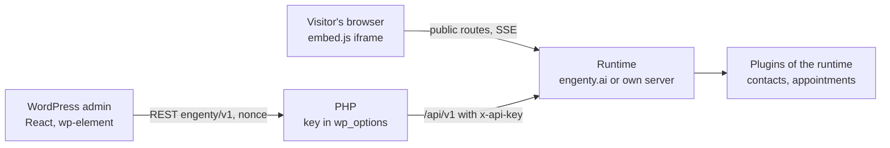
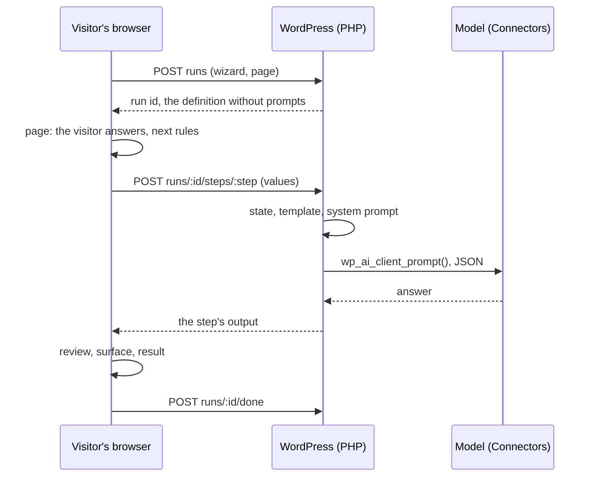

# Plan: the WordPress plugin

Status: built on 2026-10-09 (see [Built](#built) at the end; it changes some decisions below:
cloud only, sign-up and sign-in by OAuth instead of a pasted key, the site reads itself in).
Mockups (WordPress admin with the studio look inside, German UI):
https://claude.ai/artifact/8u9iU2ABq2oPo93w1o11Ti

Scope: a WordPress plugin that puts published wizards on a WordPress site (block, shortcode,
Elementor widget, PHP, a bubble on every page), lists the wizards and their results in the
WordPress admin, and shows what the Pro plugins collected there (contacts, appointments).
Building wizards stays in the studio.

## Decisions

| Question | Decision | Why |
|---|---|---|
| Can the runner run in PHP on a WordPress host? | No. The plugin is a client of a runtime | The engine is TypeScript: steps, model calls through the gateway, tools, the sandbox, SSE streams, plugins. A PHP port is a second engine. A typical host has PHP only: no Node, no long-lived process, request timeouts under a minute, no SSE |
| Which runtime? | engenty.ai by default (the account's cloud runtime); an own server ([server.md](../content/user/server.md)) as the second way; a local install only for `localhost` | The same three places the share dialog knows today |
| Studio in WordPress? | No. The admin lists, starts, embeds and reads. "Im Studio öffnen" links out | A studio in the admin is a second studio to keep in step |
| Who talks to the runtime? | Visitors: the browser, straight to the runtime through `embed.js` (iframe), as on any website. The admin: PHP, with the API key kept in `wp_options`, never in the browser | Runs need SSE, uploads, camera, Turnstile: the iframe already has them. The key must not leak into pages or the editor |
| Plugins of the runtime in WordPress? | The WordPress plugin ships a page for the plugins a website cares about: `contacts` (leads) and `appointments` (bookings). Each reads the plugin's own HTTP routes with the key. A plugin the WordPress plugin knows nothing about shows nothing | The studio half of a plugin is React built against the studio; it cannot load in the admin. A generic "any plugin's table" needs a descriptor the SDK does not have; two concrete pages are honest and small |
| License and repository | Own public repository, GPLv2 or later | WordPress.org takes only GPL-compatible plugins; the runtime's FSL license is not. Nothing of the runtime is copied: the plugin is PHP plus a small React admin |
| What WordPress stores | Settings, the key, a cached wizard list (transient, 5 minutes). No runs, no answers | Results stay where they are run; the admin reads them live. Less to protect, nothing to delete |

## What exists that the plugin builds on

| Need | Exists today | Where |
|---|---|---|
| Show a wizard on a page | `embed.js`, `data-wizard`, `data-mode="inline" \| "modal"`, `data-label`; the button takes the site's styles | `apps/web/public/embed.js`, [test-and-share.md](../content/user/test-and-share.md#embed-in-a-website) |
| The chat runner, `data-runner="chat"`, `data-mode="popout"` | On the branch `claude/wizards-vs-bot-ui-1044fe` | [runners-and-voice.md](https://github.com/engenty/engenty-wizards/blob/claude/wizards-vs-bot-ui-1044fe/docs/plans/runners-and-voice.md) § D |
| What a visitor's browser calls | `GET /api/public/wizards/:token`, `POST …/runs` (Turnstile, 6 runs an hour per visitor, 50 a day per link), `/api/runs/:id/*` | `apps/runtime/src/routes/runs.ts` |
| A key for a client | `wz_…` API keys: a local install's under Settings → Einbinden, an account's in the Manage-App. Taken as `x-api-key` or a bearer on `/api/v1` and `/api/mcp` | `apps/runtime/src/mcp/auth.ts`, [manage-contract.md](../manage-contract.md#tokens) |
| List the wizards with a key | `GET /api/v1/spaces` → spaces with `wizards: [{ id, title, publishedVersion, shareUrl, shareEnabled }]` | `apps/runtime/src/routes/api.ts` |
| A plugin's routes | `server.registerHttpRoute` below `/api/studio/plugins/<id>` (session only) | [routes.md](../content/dev/plugins/routes.md) |
| Leads, bookings | `contacts` lists people with `q`, `type`, `role`, `wizard`, pages of 50; `appointments` keeps bookings per person | `engenty-wizards-manage/plugins/{contacts,appointments}` |
| Where the plugin shows up in the studio | Settings → Einbinden lists the AI apps and, under "Teilen", the link and the website tag | `apps/web/src/studio/Integrate.tsx` |

## The plugin

Slug `engenty-wizards`, name "engenty wizards", PHP ≥ 8.1, WordPress ≥ 6.5. One repository,
`engenty/wordpress`, released as a zip on GitHub and later through WordPress.org.



### Pages of the admin

Menu "engenty" with the engenty mark, below "Kommentare".

| Page | Shows | Who |
|---|---|---|
| Wizards | The published wizards of the space: engenty, title, version, where it runs (engenty.ai, own server), link on or off, which plugin it needs. Per wizard: Starten (opens the link), Einbetten (shortcode, block hint, PHP line), Im Studio öffnen. "Neu laden" drops the cache | `edit_posts` |
| Ergebnisse | Runs of the space, newest first: wizard, when, status, the page it ran on, the person's e-mail where the wizard asked one. A row opens a drawer: the answers, the outputs with downloads, the share page | `engenty_results` (given to administrators and editors on activation) |
| Kontakte | Only when the runtime has `contacts`: the leads, search, source wizard, CSV export link. A contact opens in the studio | `engenty_results` |
| Termine | Only when the runtime has `appointments`: the next bookings, cancelled ones, per wizard | `engenty_results` |
| Einstellungen | Verbindung (address, key, "Testen", what the key sees: space, plan, plugins), Darstellung (default mode, button label, the bubble on every page and on which pages), Datenschutz (the sentence for the site's privacy statement, with the runtime's address), Zugriff (which roles see results) | `manage_options` |

Before a connection every page shows the connect screen: engenty.ai (sign in there, make a key
under Einbinden → WordPress, paste it) or an own server (address and key).

### Putting a wizard on a page

All five ways render the same tag. The plugin adds `data-source="wordpress"` and the page's
address so a run knows where it came from (`run.origin`, below).

| Way | How | For |
|---|---|---|
| Block `engenty/wizard` | Pick the wizard, the mode (Im Text, Button + Fenster, Chat, Chat-Blase), the button label. The editor shows the real wizard in an iframe | Gutenberg, the site editor |
| Shortcode | `[engenty_wizard id="TOKEN" mode="modal" label="Anfrage starten"]`; also `[engenty_wizard]` with the default of the settings | Classic editor, page builders with a shortcode widget, widgets |
| Elementor widget | "engenty Wizard" in the "Allgemein" group, the block's controls, live in the canvas | Elementor |
| PHP | `engenty_wizard( 'TOKEN', [ 'mode' => 'inline' ] )` echoes the tag | Themes, templates |
| Bubble | Settings: one wizard as a bubble bottom right on every page, or on chosen pages. A chat bubble when the chat runner is on | Support, lead capture |

`id` takes the share token or the wizard's ID (the code the mobile app takes); the plugin
resolves the code through `GET /api/public/codes/:code` once and caches it.

Modes map to `embed.js`: `inline`, `modal`, `chat` (`data-runner="chat"`, from the branch),
`bubble` (new, below).

### What the admin calls

PHP registers `engenty/v1/*` REST routes (nonce, capability) and forwards to the runtime with
`x-api-key`. The browser never sees the key or the runtime's address of the key.

| REST route | Runtime call | Cached |
|---|---|---|
| `GET status` | `GET /api/v1/me` | no |
| `GET wizards` | `GET /api/v1/wizards` | 5 min transient |
| `GET runs?wizard=&page=`, `GET runs/:id` | `GET /api/v1/runs`, `GET /api/v1/runs/:id` | no |
| `GET contacts?q=&page=` | `GET /api/v1/plugins/contacts/?q=…` | no |
| `GET appointments?from=` | `GET /api/v1/plugins/appointments/bookings?from=…` | no |
| `POST settings` | `GET /api/v1/me` to test, then save | — |

## What the runtime needs (open repository)

| Change | Where | Phase |
|---|---|---|
| `GET /api/v1/me` → `{ user, tenant: { id, name, plan }, runtime: { url, kind: "cloud" \| "server" \| "local" }, plugins: [id], scopes }` with a key | `routes/api.ts` | 1 |
| `GET /api/v1/wizards` → the published wizards of the key's space: `{ id, token, code, title, description, avatar, publishedVersion, shareUrl, shareEnabled, runners, plugins }`. `runners` from `PublicWizard.runners` once the branch merges, `["steps"]` before | `routes/api.ts`, reads what `GET /spaces` and `GET /api/public/wizards/:token` read | 1 |
| Scope `runs:read`; `GET /api/v1/runs?wizard=&status=&page=` and `GET /api/v1/runs/:id` → `RunReport` plus the answers and signed download links, as the studio's results page has them | `mcp/scopes.ts`, `routes/api.ts`, `services/runs.ts`; the Manage-App's key page offers the scope | 2 |
| `run.origin`: the page a run was started on, from `embed.js` (`document.referrer` of the frame's parent, sent with `embedded`) | `db/schema.ts`, `routes/runs.ts`, `embed.js`; shown on the space's results too | 2 |
| `data-mode="bubble"`: a round launcher bottom right that opens the modal, or the chat popout with `data-runner="chat"` | `embed.js`; the share dialog's "Website" gets the third mode | 2 |
| `/api/v1/plugins/:id/*` → the plugin's `registerHttpRoute`s with the key's user and role; `403 { code: "plugin" }` when the tenant lacks the plugin | `routes/api.ts`, `routes/plugins.ts` | 3 |
| Settings → Einbinden: "WordPress" under "Teilen", with the key (a local install: made there; an account: a link to the Manage-App's key page) and the plugin's download | `studio/Integrate.tsx`, `lib/i18n.ts` | 1 |
| `apps/docs`: a user page "WordPress" beside "Test and share" | `docs/content/user/wordpress.md` | 1 |

A local install answers only on `localhost`: the connect screen says so and that visitors need
engenty.ai or an own server, as the share dialog does.

## Phases

| Phase | Builds | Done when |
|---|---|---|
| 1 · Connect and embed | PHP skeleton, settings, connect screen, `/me` and `/wizards`, Wizards page, shortcode, block, PHP function, Einbinden entry, docs page | A wizard from engenty.ai runs inside a WordPress page from the block and from a shortcode, on a stock theme and on a host with PHP only |
| 2 · Results and the bubble | `runs:read`, Ergebnisse page with the drawer, `run.origin`, the bubble, Elementor widget | An editor reads a run's answers and downloads its PDF in the admin; the bubble opens the chat runner on every page |
| 3 · Plugins | `/api/v1/plugins/:id`, Kontakte, Termine, Zugriff settings | Leads a wizard collected on the site show under Kontakte without the studio |
| 4 · Listing | WordPress.org submission, readme.txt, screenshots, the release on GitHub, a starter "Website-Anfrage" among the templates | The plugin installs from the WordPress admin's plugin search |

## Open decisions

- The key's scopes: today a key carries the user's role, no scopes. Either `runs:read` is implied
  by the role, or the Manage-App's key page gets checkboxes. Role only is simpler.
- Allowed sites: should a wizard's link say which origins may embed it (the frame refuses
  others)? Not in the plan; the daily limit and Turnstile stand. Worth it once a link is on a
  busy site.
- Results in the WordPress database: none in this plan. A site that wants its own copy needs a
  webhook from the runtime (`on("run.done")` is a plugin hook; a per-key webhook address does not
  exist).
- Consent: a wizard that asks for contact data needs the site's privacy statement to name the
  runtime. The settings give the sentence; whether the first page of the wizard shows a consent
  line is the wizard's own business (see the GDPR note in the roadmap).
- The chat runner and the bubble need the branch `claude/wizards-vs-bot-ui-1044fe` merged;
  phase 1 does not.

## Implementation

Written on 2026-10-09. Two repositories move: the open runtime (this one) gets the API, the
plugin gets its own repository.

### Repositories

| Repository | Holds | License | Why apart |
|---|---|---|---|
| `engenty/engenty-wizards-wordpress` (new, public) | The WordPress plugin: PHP, the block, the admin app, `readme.txt` | GPLv2 or later | WordPress.org takes only GPL-compatible code; the runtime is FSL. A separate repository keeps the licenses apart and gives the plugin its own releases, tags and issues |
| `engenty/engenty-wizards` (this) | `/api/v1/me`, `/wizards`, `/runs`, `/plugins/:id`, `run.origin`, the bubble in `embed.js`, Einbinden → WordPress, the docs page | FSL | The API the plugin calls |
| `engenty-wizards-manage` | A key page that says "for WordPress" and the `runs:read` scope if scopes get checkboxes | closed | Keys of an account are issued there |

The plugin's repository copies nothing from the runtime. The shapes it reads (`/api/v1/me`,
`/wizards`, `/runs`) are documented in `docs/manage-contract.md` here and mirrored as PHP
arrays there; no shared package.

### The plugin repository

```
engenty-wizards-wordpress/
├── engenty-wizards.php          header, constants, autoload, activation (capability engenty_results)
├── readme.txt                   WordPress.org readme
├── uninstall.php                removes the options and transients
├── includes/
│   ├── class-settings.php       option engenty_wizards: address, key (encrypted with AUTH_KEY), defaults, bubble, access
│   ├── class-client.php         wp_remote_get/post to the runtime with x-api-key; errors as WP_Error with the runtime's code
│   ├── class-rest.php           engenty/v1: status, wizards, runs, runs/:id, contacts, appointments, settings
│   ├── class-admin.php          menu "engenty", the pages (one <div id="engenty-app">), enqueues the admin app
│   ├── class-embed.php          engenty_wizard() and the tag: embed.js of the runtime's address, data-wizard, data-mode, data-label, data-runner, data-source="wordpress", data-page
│   ├── class-shortcode.php      [engenty_wizard id mode label runner]
│   ├── class-bubble.php         wp_footer: the bubble tag on the pages the settings name
│   └── class-elementor.php      loaded on elementor/widgets/register: the widget
├── blocks/wizard/
│   ├── block.json               engenty/wizard, attributes token, mode, label, prefill; render.php
│   ├── edit.js                  InspectorControls: wizard (from engenty/v1/wizards), mode, label, prefill; the preview iframe
│   └── render.php               calls engenty_wizard()
├── src/admin/                   the admin app: React through @wordpress/element, @wordpress/components for inputs
│   ├── index.tsx                router by ?page=engenty-… 
│   ├── Wizards.tsx  Results.tsx  Contacts.tsx  Appointments.tsx  Settings.tsx  Connect.tsx
│   └── api.ts                   apiFetch to engenty/v1 with the nonce
├── package.json                 @wordpress/scripts: build, start, lint; outputs build/
├── composer.json                PHPCS with WordPress-Coding-Standards, PHPUnit
├── tests/                       PHPUnit on the embed tag, the shortcode, the REST routes (runtime mocked with pre_http_request)
└── .github/workflows/           lint, phpunit, build, the zip on a tag
```

- The admin pages carry the studio's look inside WordPress' chrome (as the mockups): Geist
  and Space Grotesk from Google Fonts, ember `#e0531b`, the cards. Inputs are
  `@wordpress/components`, so they behave like WordPress.
- Capabilities: `manage_options` for Einstellungen, `edit_posts` for Wizards and the block's
  wizard list, `engenty_results` for Ergebnisse, Kontakte and Termine. The Zugriff section
  gives or takes `engenty_results` per role.
- The REST layer never forwards the runtime's address or the key. It forwards the runtime's
  `code` (`insufficient_scope`, `plugin`, `tenant_suspended`) so the app can say what is wrong.
- The wizard list is a transient of five minutes; "Neu laden" and a saved connection drop it.
- The embed tag's `data-page` is the page's permalink; the frame sends it with `embedded`
  (below) so a run carries where it started.

### Runtime changes, in order

| # | Change | Files | Reuses |
|---|---|---|---|
| 1 | `GET /api/v1/me` with a key or token: `{ user: { id, name }, tenant: { id, name, plan }, runtime: { url, kind }, plugins: string[], scopes }` | `routes/api.ts` (`caller`, `inTenantAs`), `manage.ts` for plan, `plugins/registry.ts` `pluginIdsOf` | `principalOf`, `tenantStatus` |
| 2 | `GET /api/v1/wizards` (`wizards:read`): the tenant's published wizards with `token`, `code`, `title`, `description`, `avatar`, `publishedVersion`, `shareUrl`, `shareEnabled`, `dailyRunLimit`, `plugins` (tool names `<plugin>.<tool>` in the definition, as the marketplace reads them), `runners: ["steps"]` until the branch merges; `unavailableReason` from `wizardUnavailable` | `routes/api.ts`, a `listPublishedWizards(tenant)` in `services/wizards.ts` | what `GET /spaces` and `GET /api/public/wizards/:token` build |
| 3 | Scope `runs:read` in `mcp/scopes.ts`; `GET /api/v1/runs?wizard=&status=&q=&page=&days=` paged by 50 and `GET /api/v1/runs/:id` → `runReport` plus the answers and the outputs' signed links | `mcp/scopes.ts`, `routes/api.ts`, `services/runs.ts` (`listResults`, `runReport` lifted off the owner's user id onto the tenant) | the studio's `GET /projects/:id/results` |
| 4 | `run.origin`: `POST /api/public/wizards/:token/runs` takes `origin` (a URL, ≤ 2 KB) beside `embedded`; `embed.js` passes `data-page` or `location.href` of the parent through the frame's query (`?embed=…&page=…`) and the runner sends it; the results page and `/api/v1/runs` show it | `db/schema.ts` + migration, `routes/runs.ts`, `apps/web/public/embed.js`, `runner/useRun.ts`, `studio/project` results | `visitorId`, `embedded` |
| 5 | `data-mode="bubble"` in `embed.js`: a round launcher bottom right with an optional `data-text`, opens the modal; with `data-runner="chat"` the chat popout once the branch is in. The share dialog's "Website" offers it as the third mode | `embed.js`, `studio/editor/ShareDialog.tsx`, `lib/i18n.ts`, `docs/content/user/test-and-share.md` | the modal's dialog and styles |
| 6 | `/api/v1/plugins/:id/*` with a key (`wizards:read`): the plugin's `registerHttpRoute`s, the key's user as `request.user`, `role === "admin"` routes need owner or admin; `403 { code: "plugin" }` when the tenant lacks it | `routes/api.ts` mounts `dispatch` of `routes/plugins.ts` with a `Principal` from the key | `dispatch` as it is, given the principal instead of the session user |
| 7 | Einbinden: "WordPress" under "Teilen": on a local install the key is made in place (`listLocalKeys`, `createLocalKey`), on an account a link to the Manage-App's key page; the plugin's download link and the three steps | `studio/Integrate.tsx`, `lib/i18n.ts` | the API-key rows the page has |
| 8 | Docs: `docs/content/user/wordpress.md` (install, connect, block, shortcode, bubble, results, privacy), a line in `test-and-share.md` and the plugin's reference of `/api/v1` in `docs/manage-contract.md` | `apps/docs` | — |

Tests: `apps/runtime/test/api.test.ts` for 1, 2, 3, 6 with a key on a runtime that runs alone
and with a stubbed Manage-App for `/me`; `embed.js` has no tests today, so 4 and 5 are tried
by hand on the docs site, which already embeds a wizard.

### Order and checkpoints

| Step | Work | Checkpoint |
|---|---|---|
| 1 | Runtime 1, 2, 7; release `v0.2.x` | `curl -H "x-api-key: wz_…" https://engenty.ai/api/v1/wizards` lists the wizards; a local install shows the WordPress entry under Einbinden |
| 2 | Plugin repository: skeleton, settings, client, REST `status` and `wizards`, the connect screen, the Wizards page | On a fresh WordPress (`wp-env`) the plugin connects to engenty.ai and lists the wizards |
| 3 | `engenty_wizard()`, the shortcode, the block with its preview, the Einbetten panel | The Angebotsanfrage runs inside a page from the block, the shortcode and a template, on Twenty Twenty-Five and on a host with PHP only (a Hostinger plan, through the Hostinger MCP) |
| 4 | Runtime 3, 4, 5; release | A run started from a WordPress page shows the page in the studio's results |
| 5 | Plugin: Ergebnisse with the drawer, the bubble, the Elementor widget | An editor opens a run and downloads its PDF in the admin; the bubble shows on every page but Impressum and Datenschutz |
| 6 | Runtime 6; plugin: Kontakte, Termine, Zugriff | A lead a wizard collected shows under Kontakte for a Shop-Manager, not for an Autor |
| 7 | Docs 8, `readme.txt`, screenshots from the mockups' data, the zip on a GitHub tag, WordPress.org submission | The plugin installs from a zip, later from the plugin search |

Steps 1 and 2 can run side by side: the plugin's client is written against the shapes in this
plan and tried against a local runtime (`PLUGINS_DIR` with contacts for step 6).

### Not in this implementation

- A results copy in the WordPress database and a webhook for it.
- Allowed origins per link.
- A plugin page for plugins the WordPress plugin does not know.
- Signing in to engenty.ai from the WordPress admin (OAuth): the key is pasted.

## Built

Built on 2026-10-09 in three repositories, committed, not pushed.

| Repository | Branch | What |
|---|---|---|
| `engenty-wizards-wordpress` (new, `/Users/m/code/engenty/engenty-wizards-wordpress`, no remote yet) | `main` | The plugin: OAuth connect with sign-up and sign-in, setup in three steps, Wizards, Ergebnisse, Kontakte, Termine, Einstellungen, block, shortcode, Elementor widget, PHP function, bubble, `readme.txt`, zip, CI with a smoke test in a real WordPress |
| `engenty-wizards` (this) | `claude/wordpress-plugin-architecture-cf4e26` | `/api/v1/me`, `/wizards` (GET, POST from a template), `/templates`, `/runs`, `/runs/:id`, `/space`, `/space/site`, `/plugins/:id/*`; scope `runs:read`; `run.origin` (migration `0011_run_origin`); `embed.js` bubble and `data-page`; Einbinden → WordPress; share dialog's third mode; docs `user/wordpress.md`, the contract's section "Clients of an account" |
| `engenty-wizards-manage` | `feat/wordpress` | Scope `runs:read` on the consent page; the sign-in page takes `login_hint` and `prompt=create` ("Kostenloses Konto anlegen"); `/billing?upgrade=pro` opens the Pro plan; plan line "Termine" |

What changed against the plan above:

| Plan | Built | Why |
|---|---|---|
| engenty.ai or an own server, key pasted | engenty.ai only (`ENGENTY_WIZARDS_CLOUD` for development); OAuth with PKCE, the site registers itself as a client like an MCP client | Asked for: cloud only, sign-up and sign-in from WordPress. The Manage-App already is the OAuth server of MCP clients |
| — | "Website einlesen": the plugin reads name, tagline, logo, theme colours, e-mail and phone of imprint and contact, the WooCommerce address and the pages as Markdown inside WordPress; the admin unticks what should not go; `POST /api/v1/space/site` fills the space's empty details, writes the pages into Wissen (origin `wordpress`) and runs the space assistant on the rest | Asked for: a process that reads in the site's base data. Read in WordPress, so a site nobody outside reaches yet works too |
| — | "Ersten Wizard anlegen" from `/api/v1/templates`, published at once | The setup ends with a wizard on the site |
| Kontakte, Termine when the runtime has the plugin | Same, and the runtime answers `403 { code: "plugin" }` for a plan without it; the admin shows a Pro page with the upgrade link instead | Asked for: only Pro has contacts and bookings |

Upgrade prompts: the header (plan, credits, "Upgrade" on Free), "Pro" marks on Kontakte and Termine
in both menus, the Pro pages, locked templates, the reading step on a plan without `build`, a notice
on the dashboard and the plugin list while the site is not connected, a notice when credits run
low, "Kostenlos verbinden" beside the plugin's name and in the block and the Elementor widget.

Tried on 2026-10-09 against a local stack (Manage-App, gateway and cloud runtime from source, the
closed plugins loaded, WordPress 6.8 with SQLite): sign-up from WordPress to consent and back, the
Free account's gates, Pro after switching the plan, reading the site (4 pages into Wissen), a
template live, the bubble on every page, a run with its page as origin, Kontakte with a contact,
Termine, disconnect and sign-in again, token refresh, the block in the editor, the shortcode with
a wizard's ID, the Elementor widget's registration.

Open:

- **Free builds nothing on the cloud** (`limits.build: false`): on Free the plugin connects, lists
  and embeds wizards published from the local app and reads results, but reading the site in and
  making a wizard from a template need Pro. Turning `build` on for Free (the plan's limits in the
  admin app) makes the whole setup work on Free, with no change to the plugin.
- Sign-up needs an invitation code while `SIGNUP=code`; the sign-in page offers it.
- A site on plain `http` cannot connect (the account server takes only https redirects but for
  loopback); the plugin says so.
- The repository `engenty/engenty-wizards-wordpress` on GitHub, the first release tag, WordPress.org.
- The chat runner as the bubble's runner once `claude/wizards-vs-bot-ui-1044fe` is merged.


## Standalone: wizards that run without an account

Planned on 2026-10-09 after the build above; not built. Asked for: wizards installed from the
studio, shipped with the plugin or from an uploaded package run on the site by themselves — no live
connection to the studio, which needs an account and stays on engenty.ai. Decided then: the
plugin checks what every wizard needs and labels the ones that need an account instead of hiding
them. Explored first were three ways (A: an engine in PHP, B: an engine in the browser, C: the
split below); C was chosen. Corrected the same day on the mockups: the start stays the hero;
"Eigene KI erstellen" opens one choice — a free account at engenty (large) or, smaller below it,
local with the AI provider the site already has; a local site picks from wizards that ship with
the plugin, runs them without engenty credits, and is sold more later through the studio,
contacts, appointments and documents. The reason for the local way: a plugin on WordPress.org
has to work on its own. Mockups (the built plugin's own styles with what standalone adds; pages
Admin, Website, Studio): https://claude.ai/artifact/M7vrhceNS6hRZdXg4yt5Uy

### Decisions

| Question | Decision | Why |
|---|---|---|
| Where does the engine run? | Split. The visitor's browser follows the flow and draws every page, review, surface and result; PHP keeps the definition with its prompts, keeps the run, fills the templates, calls the model once per thinking step | A browser-only engine would publish every prompt in the page source. PHP never holds a request longer than one model call: hosts allow 30–60 s and no SSE. Nothing of the engine is written twice: flow, fields, surfaces and views are the shared TypeScript as it is; PHP ports only the template renderer and the one call |
| Which model? | The one the site owner set under Einstellungen → Connectors: WordPress 7.0's AI Client, `wp_ai_client_prompt()`. OpenAI, Anthropic and Google come with core; Ollama and others through provider plugins ("AI Provider for Ollama"); later our own "AI Provider for engenty", credits through the same screen | No key of ours and no key field of our own; a local LLM is literally that when the site runs Ollama. Sources: [AI Client](https://make.wordpress.org/core/2026/03/24/introducing-the-ai-client-in-wordpress-7-0/), [Connectors](https://make.wordpress.org/core/2026/03/18/introducing-the-connectors-api-in-wordpress-7-0/), [Ollama provider](https://wordpress.org/plugins/ai-provider-for-ollama/) |
| Chrome's built-in model? | No | Desktop only, a 4 GB download, no Safari or Firefox; visitors are on phones |
| How does a site get there? | Übersicht → "Eigene KI erstellen" → the choice: the account (large: Konto anlegen, Anmelden) or "Lokal, mit eigenem KI-Anbieter" (small, below, naming the provider the Connectors already have) → the local setup in three steps: provider, wizards, on the site | The account stays the main way; local is the self-contained way, not a second product |
| Where do local wizards come from? | A set that ships with the plugin: `wizards/*.wizard`, exported at release from the open repository's templates that pass the check with `full`; plus a `.wizard` upload from the studio. No gallery call | Self-contained: nothing is fetched to run; the gallery is engenty.ai's and stays an account feature |
| Credits | A local run costs engenty nothing and is not metered; the provider bills the site's key | Asked for: basic wizards without credits, the upsell comes through other features |
| What may run standalone? | One shared function says per wizard: full, with less, or needs an account — with the steps and why. Computed in the studio and on upload from the same code; the shipped set is `full` by construction | Two places, one opinion |
| Filter or label? | Label. In the studio and on a connected site a wizard that needs an account stays listed with the reason; an upload that cannot run is refused with its notes and the account path | The account is the way up, not a dead end |
| Where do results go? | A WordPress table; Ergebnisse shows them beside the cloud's. Nothing is sent to engenty.ai | No account on the site. Answers the open decision "results in the WordPress database" for this mode |
| Two modes | A wizard runs either connected (as built above) or standalone; both kinds can be on one site, the list says which | A connected site keeps contacts, bookings and files; a site without an account still runs the simple ones |
| WordPress version | Standalone needs 7.0 (the AI Client); the connected mode stays at 6.6 | Below 7.0 the plugin shows the connected mode only |
| License | The runner subset becomes its own package `@engenty-wizards/runner` under MIT, the plugin bundles it; the runtime stays FSL | WordPress.org takes only GPL-compatible code. Loading it from engenty.ai would be remote code, and no longer standalone |

### What exists that this builds on

| Need | Exists today | Where |
|---|---|---|
| A wizard as a file | `.wizard`: a zip with a manifest, the definition and the workspace (25 MB); `exportWizard`, `importWizard`, `PACKAGE_MIME` | `apps/runtime/src/services/package.ts`, the editor's download icon, "Import" on the first page |
| The same over the API | `POST /api/v1/wizards/import` takes `{ definition, files: [{ path, data, mime }], publish }` | `apps/runtime/src/routes/api.ts` |
| The gallery's entries | An entry is built from a definition and its files; starters are kept offline; `plan=free\|pro` facet, `pluginStarter` | [marketplace-contract.md](../marketplace-contract.md), `packages/shared/src/marketplace-entry.ts` |
| What a wizard needs | `stepClasses`, `unavoidableSteps`, `unavoidableFrom`, `optionalCapabilities`, `closedChoices`, `openValue` — for model classes, on the runtime | `apps/runtime/src/engine/requirements.ts` |
| A view the runner draws | `RunView`; `RunnerBody` reads it through `useRun` (SSE) and sends commands | `packages/shared/src/run.ts`, `apps/web/src/runner/RunnerView.tsx`, `useRun.ts` |
| Pure logic | Next rules and loops, decided fields, `isDecisionStep`; templates `{{field}}`, `{{steps.id}}`, `{{brand.name}}`; `decide()` with the LLM as fallback; the surface catalog and its renderer; the fields with camera, signature, location | `packages/shared/src/definition.ts`, `apps/runtime/src/engine/template.ts`, `engine/decide.ts`, `packages/shared/src/surface.ts`, `apps/web/src/runner/{surface,fields}.tsx` |
| The system prompt of a thinking step | `GROUND_RULES`, today, `brandBlock`, `knowledgeBlock`, the format hint; the person's answers as text | `apps/runtime/src/engine/steps.ts`, `engine/input.ts` |
| The site's own brand | Name, tagline, logo, colours, e-mail, phone, address, pages — read inside WordPress | `includes/class-site-reader.php` in the plugin |
| WordPress 7.0 | `wp_ai_client_prompt()`: system instruction, JSON answers, images, function calling through Abilities; no streaming before 7.1 | [WP_AI_Client_Prompt_Builder](https://developer.wordpress.org/reference/classes/wp_ai_client_prompt_builder/), [7.1 preview](https://make.wordpress.org/ai/2026/06/19/whats-coming-to-the-ai-client-in-wp-7-1/) |

### The check

`needs(step)` in `packages/shared`, beside `isDecisionStep`: what a step wants beyond a text
model, as stable ids so every app can word them. `standaloneFit(def)` folds them with
`unavoidableSteps` (lifted into shared, it is pure) into one answer.

| Need id | From | Hard or soft |
|---|---|---|
| `tool:web_search`, `tool:browser`, `tool:sandbox`, `tool:image` | `agent.tools` | hard |
| `tool:http`, `tool:web_fetch` | `agent.tools` | hard in phase 2, soft once the PHP tool loop exists (phase 4) |
| `tool:pages` | `agent.tools` | soft: the step runs without the space's pages |
| `mcp`, `connections` | `agent.mcp`, `agent.connections` | hard |
| `plugin:<id>` | `agent.call`, tools named `<plugin>.<tool>` | hard; the note says the plan (Pro) |
| `asset:video`, `asset:voice`, `asset:document`, `asset:dashboard` | `generate.asset` | hard |
| `asset:image` | `generate.asset` | hard until the AI Client's image generation is tried |
| `film`, `widget:video` | step type, `widget.video` | hard |
| `field:audio`, `field:connection`, `field:slot` | page fields | hard; an optional `audio` field is soft (it is left out, as the cloud does) |
| `field:file` | a `file` field a later thinking step reads | hard: `read_document` is Node |
| `field:image`, `field:location` | page fields | soft: photos go to the model where the provider takes images, else the step runs without them; a typed address stands in for geocoding |
| `format:pdf`, `docx`, `xlsx`, `png`, `mp4`, `mp3`, `zip` | result deliverables | soft when another format of the same output stays (html, md, txt, csv, json); hard when none does |
| `lists`, `memory` | `def.lists`, the `list` field kind, `{{memory}}` | hard |
| `each` | `agent.each`, `generate.each` | soft: runs, one request per entry, slower |

| Fit | When | Standalone runner does |
|---|---|---|
| full | no hard need, no soft need | runs as is |
| less | hard needs only on avoidable steps, or soft needs anywhere | the choices leading to a hard need are closed as `closedChoices` closes them in the cloud (generalised: it takes the lacking set instead of `missingClasses`); soft needs run with less |
| no | a hard need on an unavoidable step | not installed; the notes say which steps and what they need |

Notes are `{ stepId, need }` pairs; the apps word them in the person's language: "Angebot als
PDF: macht eine PDF", "Termin buchen: braucht Termine (Pro)", "Fotos: gehen nicht an das Modell".

| Where it shows | Shows | Filter |
|---|---|---|
| Plugin · Wizards, connected | per wizard a label: "Läuft hier ohne Konto" / "Läuft hier mit weniger: …" / "Nur über dein Konto" | — |
| Plugin · Wizard hinzufügen (mitgeliefert) | nothing: every shipped wizard is `full`; the picker shows title and what it asks | — |
| Plugin · Importieren | the admin app computes it on the package before PHP stores it: "no" is refused with the notes and the account path; "less" is stored with its notes | — |
| Studio · share dialog, Einbinden → WordPress | "In WordPress ohne Konto: ja / mit weniger / nein, weil …" and a link that asks the assistant to adapt the wizard | — |
| Gallery (engenty.ai/wizards), later | a badge from the same function, computed when the entry is built, for account users who want to know what also runs locally | facet `runs=wordpress` |

The studio computes it server-side; the plugin trusts those labels for a connected site's
wizards and computes it itself only for uploads.

### What runs standalone

| Runs | With less | Not standalone |
|---|---|---|
| Pages with every field but `audio`, `connection`, `slot`; thinking steps without tools (text, markdown, json); decisions, decided fields, branches and surfaces; `review`; `surface`; `widget`; results as html, md, txt, csv, json | photos and addresses (above); `pages` without Wissen; `each`; PDF through the browser's print | tools, accounts, MCP, Pro plugins; films; video, voice, document and dashboard generation; file reading; lists and memory; docx, xlsx, png, mp4, mp3, zip |

Fits: lead and contact forms, quotes and price estimates, advice and recommendations, checklists
and classifications, text generators, anything that is pages, thinking and a text or JSON result.

| Door ([wizard-channels.md](https://github.com/engenty/engenty-wizards/blob/claude/wizards-vs-bot-ui-1044fe/docs/plans/wizard-channels.md)) | Standalone |
|---|---|
| Screen, steps: inline, button + modal, bubble, an own page, QR to it | yes |
| Headless: start a run and read it over WP REST | yes, the same routes |
| Chat runner | later: one model call per message fits PHP; the chat engine is Node and on its branch. Dictation no; reading aloud maybe (the AI Client has text-to-speech) |
| Agent host (MCP) | later: WordPress 7.0's Abilities API and MCP Adapter could expose a wizard; not here |
| Live voice, live video, phone, WhatsApp, SMS, Slack, e-mail, the mobile app | no — a runtime and its plugins |

### How a run works



The browser holds the `RunView` and draws it with the runner package; PHP holds the `RunState`
(values, outputs, history) in the run row, so Ergebnisse shows a run while it is on and nothing
depends on the visitor's tab. A page step is sent as values; a step that needs the model
(thinking step, decision, decided fields, decided surface) is asked for by id and answered with
its output, the shown fields or the chosen target. One request, one model call.

### The plugin's parts

| Part | Does | Where |
|---|---|---|
| Packages | Table `engenty_wizards`: id, title, token, definition (JSON), fit and notes, source (bundled, studio, upload), overrides, installed at; files under `uploads/engenty-wizards/<id>/` | `includes/class-packages.php` |
| Import | The admin app unpacks the `.wizard` (fflate), checks it against the shared schema, computes the fit, posts definition, files and fit; PHP checks size and shape and stores it. Only `manage_options` | `src/admin/Import.js`, REST `POST engenty/v1/packages` |
| Mitgeliefert | `wizards/<id>.wizard` in the plugin's zip, exported at release from the open repository's templates (`fit === "full"` only, `pnpm templates:export` in CI, copied by the plugin's release workflow); listed by `class-packages`, activated in the local setup's step 2 and under "Wizard hinzufügen" | `wizards/`, `includes/class-packages.php`, `.github/workflows/release.yml` |
| Anpassen | A shipped wizard's texts without the studio: title, description, intro, the fields' labels and options, the result's message — stored as overrides on the row, never the structure or the prompts | `src/admin/Customize.js`, `class-packages.php` |
| From the studio | Einbinden → WordPress: "Paket herunterladen"; on a connected site a wizard's row offers "Eigenständig auf dieser Website" and pulls the package with the key | runtime change 3 below |
| Runs | Table `engenty_runs`: id, wizard, state (JSON), status, origin page, visitor hash, started, finished. Routes (public, no nonce): `POST runs`, `POST runs/:id/steps/:step`, `POST runs/:id/back`, `POST runs/:id/done`; `GET runs/:id` for the admin | `includes/class-runs.php` |
| The call | A PHP port of `renderTemplate` and `answersAsText`; the system prompt from `GROUND_RULES`, today, the site's brand (the site reader's data), the format hint; `wp_ai_client_prompt()` with the system instruction and, for json, the output schema (`outputSchema(step)` ported) as the JSON answer — the structurer's second call collapses into the one. A provider error is the step's error, retried by the visitor | `includes/class-think.php` |
| Limits | 6 runs an hour per visitor (cookie and IP hash), 50 a day per wizard, a honeypot field, Turnstile keys optional in the settings; 4 MB per request; photos as image parts only where the provider takes them | `class-runs.php` |
| Runner | `src/runner/`: the runner package plus `useLocalRun`, which makes `RunView`s from the routes above in place of `useRun`. `engenty_wizard()` emits, for a standalone wizard, a div with `data-local="<id>"` and this script instead of `embed.js`; inline, modal and bubble as today | `src/runner/index.js`, `includes/class-embed.php` |
| Admin | Wizards lists both kinds with the label and the source; Ergebnisse shows local runs in the same drawer (downloads made in the browser: html, md, json, csv); Einstellungen gets "KI-Anbieter": which connector is set, a link to Einstellungen → Connectors, the limits | `src/admin/{Wizards,Results,Settings}.js` |

### Runtime changes (open repository)

| # | Change | Files |
|---|---|---|
| 1 | `needs(step)`, `standaloneFit(def)` in shared; `unavoidableSteps`/`unavoidableFrom` lifted there; `closedChoices` takes the lacking set | `packages/shared/src/definition.ts` or a new `fit.ts`, `apps/runtime/src/engine/requirements.ts` |
| 2 | `@engenty-wizards/runner` (MIT): the runner's field, output, surface and view components and `RunnerBody` with a run source (`useRun` here, `useLocalRun` in the plugin); the studio uses the package | `packages/runner`, `apps/web/src/runner` |
| 3 | `GET /api/v1/wizards/:id/package` (`wizards:read`): the `.wizard` of the published version | `routes/api.ts`, `services/package.ts` (`exportWizard` on a published version) |
| 4 | Share dialog and Einbinden → WordPress: the fit line and "Paket herunterladen" | `studio/editor/ShareDialog.tsx`, `studio/Integrate.tsx`, `lib/i18n.ts` |
| 5 | `pnpm templates:export`: every template as a `.wizard` with its fit, into `dist/templates/`; CI attaches them to the release so the plugin's release workflow can take the `full` ones | `scripts/`, `.github/workflows/` |
| 6 | Docs: "Ohne Konto" in `user/wordpress.md`; `manage-contract.md` for the package route | `apps/docs` |

### Phases

| Phase | Builds | Done when |
|---|---|---|
| 1 · The check | Runtime 1, 4, 5 | The studio says for every template whether it runs in WordPress without an account; CI exports the templates as packages |
| 2 · The local way | Runtime 2, 3; plugin: the start flow (choice, local setup), the shipped set, packages, runs, the call, limits, the runner on block, shortcode and bubble, Ergebnisse with local runs | A fresh WordPress 7.0 with an OpenAI key goes from "Eigene KI erstellen" to a live Angebotsanfrage on a page without an account; the same with Ollama; its result shows under Ergebnisse; the prompts are not in the page source |
| 3 · More ways in | Import of a `.wizard`, "Paket herunterladen" in the studio, "Anpassen", "Hier laufen lassen" on a connected site | An exported wizard imports with its notes; a connected site switches a wizard to local and back |
| 4 · With less | Closed choices in the standalone runner; Wissen snapshot in the package (opt-in, size cap); photos where the provider takes them; `http` and `web_fetch` as a PHP tool loop with `using_abilities()` | A wizard with a PDF branch runs with that choice closed; a step reads the site's own pages |

### Open decisions

- Which templates ship: every `full` one, or a hand-picked six (the mockups show six:
  Angebotsanfrage, Störung melden, Rückruf-Wunsch, Welche Küche passt?, Checkliste Aufmaß,
  FAQ-Berater). Hand-picked keeps the plugin small and the set sensible for a website.
- Updates: a shipped wizard updates with the plugin; its overrides from "Anpassen" stay. An
  imported package is re-imported by hand.
- Wissen in the package: which pages, the size cap, and that the author agrees to ship them.
- Memory and lists: WordPress tables later, or never.
- Results back to engenty.ai from a site that connects later: no route; not planned.
- Turnstile keys in the plugin's settings, or honeypot and limits only.
- The chat runner for standalone wizards, after its branch merges.

### Not in this plan

- An engine in PHP beyond the template renderer and the one model call.
- Films, media generation, tools with a sandbox or browser, accounts, Pro plugins: connected only.
- Streaming of a thinking step's text: WordPress 7.1 may bring it.
- The mobile app for standalone wizards.

### Implementation

Written on 2026-10-09 after the mockups. Three repositories move: the open runtime gets the
check and the runner package, the plugin gets the standalone mode, the marketplace gets the badge.

#### What the mockups settled

| Where | Settled |
|---|---|
| Labels | Chips beside the wizard's title: "Läuft hier ohne Konto" (moss), "Läuft hier mit weniger" (amber, a new chip tone), "Nur über dein Konto" (ember). Under a "mit weniger" or "Konto" chip a short list, one line per step: "Entwurf als PDF: hier als Webseite und Markdown" |
| Source | A grey chip: Mitgeliefert, Paket, Studio; the small line says when it was activated or imported and how many results it had in 30 days |
| Header | A local site's header shows "Lokal · OpenAI" (a status dot, paper-2 pill) and a ghost "Mit Konto verbinden"; a connected site the plan, credits and the provider pill side by side |
| Übersicht | Only the hero, as built: "Eigene KI erstellen →", the three checks, "Schon ein Konto? Anmelden". No explanation cards |
| The choice | "Eigene KI erstellen" opens a centred card: the drop engenty, "Deine KI bei engenty", one sentence, "Kostenloses Konto anlegen →" and "Anmelden" large; under an "oder" line a small paper card "Lokal, mit eigenem KI-Anbieter" with the chip "OpenAI erkannt" (or "kein Anbieter" with the Connectors link), one sentence, "Lokal einrichten"; "Wechseln geht später jederzeit." |
| Lokal einrichten | The Übersicht's "Einrichten" card as built, three steps: 1 KI-Anbieter (done when a connector answers; "ändern"), 2 Wizards wählen (the shipped set as template cards with a checkbox each, "2 Wizards aktivieren", "Eigenes Paket importieren"), 3 Auf die Website bringen (the built Place step). Beside it the stat "0 Wizards live · läuft lokal, ohne engenty-Credits", a short "Was läuft lokal" card and a compact "Mit Konto" card with "Mehr erfahren" only; "Doch mit Konto" top right |
| Wizards | Buttons "Paket importieren" (ghost) and "Wizard hinzufügen" (primary, the shipped set); rows with the chips Live and Mitgeliefert / Paket, "Anpassen", "Einbinden", "Pausieren"; a dashed card "Noch vier mitgelieferte Wizards"; the compact "Mit Konto" card at the end with "Mehr erfahren". Connected: a local wizard shows "Eigenständig · läuft hier" and "über engenty.ai laufen lassen"; a cloud wizard that fits offers "Hier laufen lassen" |
| Importieren | A drawer: the file line, a "Geprüft" card with the fit chip and the notes, the facts (title, version, steps, files, which provider will think and how many calls a run makes), Installieren / Abbrechen |
| Ergebnisse | The same table; a local run's drawer carries "Auf dieser Website", the number of model calls, the answers, the outputs with HTML / Markdown / JSON buttons made in the browser, and a line that no contact was made |
| Einstellungen | A card "KI-Anbieter": one row per provider (OpenAI, Ollama, Anthropic, Google, engenty "später") with its state and a link to Connectors, "Bevorzugt für Wizards", a test button; a card "Eigenständige Wizards": runs an hour and a day, how long results are kept, bot protection, photos to the provider; the privacy sentence names the provider |
| The site | The runner card as the studio draws it (3 px ember progress, the wizard's engenty and title, "Schritt 2 von 4", fields in the studio's inputs, pill buttons); under it "Läuft auf dieser Website · Antworten gehen an OpenAI · Datenschutz". While PHP asks the provider: the round engenty, "Schätzt Aufwand und Preis …", three progress lines. The result: text, a JSON output as a small fact strip, save as web page / Markdown / print |
| Studio | The share dialog gets a fourth tab "WordPress": "Über dein Konto" with the plugin's download, and "Ohne Konto, auf der Website selbst" with the fit chip, the per-step list (✓ and –), "Paket herunterladen · .wizard" and "Wizard anpassen, damit alles läuft" (asks the assistant) |

#### Shapes

**The check** (`packages/shared/src/fit.ts`):

```ts
export type Need = `tool:${ToolId}` | "mcp" | "connections" | `plugin:${string}`
  | `asset:${AssetKind}` | "film" | "widget:video" | `field:${FieldKind}` | "field:file-read"
  | `format:${Format}` | "lists" | "memory" | "each";
export interface StepNeed { stepId: string; need: Need; hard: boolean }
export function needs(step: Step, def: WizardDefinition): StepNeed[];
export interface Fit { fit: "full" | "less" | "no"; notes: StepNeed[] }
export function standaloneFit(def: WizardDefinition): Fit;
/** From requirements.ts, made pure: the set of lacking things instead of the runtime's models. */
export function unavoidableSteps(def: WizardDefinition): Set<string>;
export function closedChoicesFor(def, step, values, lacking: (step: Step) => boolean): Record<string, ClosedChoice>;
```

`needs` reads: `agent.tools`, `agent.mcp`, `agent.connections`, `agent.call`, `agent.each`,
`generate.asset`, `generate.each`, `widget.video`, the step type `film`, page fields of kind
`audio` (hard when `required`), `connection`, `slot`, `location` (soft), `image` (soft), `file`
(hard when a later agent step is reachable — "field:file-read"), `result.deliverables[].formats`
(soft when another of html, md, txt, csv, json is listed for the same `from`, hard otherwise),
`def.lists` and the `list` field kind, a `{{memory` reference in any template. The texts live in
the apps (`lib/i18n.ts` in the studio, the admin app's strings in the plugin), keyed by `need`.

**The package route** (`GET /api/v1/wizards/:id/package`, scope `wizards:read`): the `.wizard`
zip of the published version as `exportWizard` makes it (`PACKAGE_MIME`), 404 while the wizard
is a draft only, `403 { code: "insufficient_scope" }` otherwise as the other v1 routes.

**The runner package** (`packages/runner`, MIT): what `apps/web/src/runner` holds minus the
network — `RunnerBody` takes a `RunSource`:

```ts
export interface RunSource {
  view: RunView | null; busy: boolean; error: string | null; notFound: boolean;
  fieldErrors: Record<string, string>;
  submitPage(stepId: string, values: Record<string, unknown>): Promise<void>;
  review(stepId: string, action: "accept" | "redo" | "edit", note?: string, text?: string): Promise<void>;
  back(): Promise<void>; retry(): Promise<void>; cancel(): Promise<void>;
  upload(file: File): Promise<AssetRef>;
}
```

`useRun` (SSE, in `apps/web`) and `useLocalRun` (in the plugin) both make one. The package also
exports the field inputs, `OutputView`, `DownloadButtons` (given a `download(format)` function),
the surface renderer and the brand header; the studio imports them from the package afterwards,
so there is one copy.

**Plugin tables** (`dbDelta` on activation and on version change):

| Table | Columns |
|---|---|
| `{prefix}engenty_wizards` | `id` char(12) pk, `title`, `description`, `token` char(22) unique (the public id in tags), `definition` longtext (JSON), `files` text (JSON list of path, mime, size — the bytes under `uploads/engenty-wizards/<id>/`), `fit` enum(full, less), `notes` text (JSON), `source` enum(bundled, studio, upload), `source_ref` (the shipped file's id, the studio wizard id, or the file name), `overrides` text (JSON, from Anpassen), `status` enum(live, paused), `installed_at`, `updated_at` |
|  `{prefix}engenty_runs` | `id` char(16) pk, `wizard_id`, `status` (waiting_input, running, done, failed, cancelled), `state` longtext (JSON: `RunState` — values, outputs, history, notes, pages, decisions), `step_id`, `origin` (the page), `visitor` char(40) (hash of cookie and IP), `calls` int, `started_at`, `finished_at` |

**Plugin REST** (`engenty/v1`, public routes without a nonce, the rest with one):

| Route | Who | Body → answer |
|---|---|---|
| `GET local/wizards/:token` | public | the definition without `instructions`, `prompt`, `brief` and `call`; the files' addresses; `fit`, `notes`; the site's brand (name, logo, colours) → the browser's `PublicWizard` plus `definition` |
| `POST local/wizards/:token/runs` | public | `{ origin, honeypot, turnstile? }` → `{ runId, view }`; 429 with `{ code: "limit" }` over the hour or day limit |
| `GET local/runs/:id` | public, the visitor's cookie | → `RunView` |
| `POST local/runs/:id/pages/:step` | public | `{ values }` → `RunView` (PHP validates against the page's fields as `readPageInput` does: required, kinds, options; closed choices refused) |
| `POST local/runs/:id/steps/:step` | public | `{}` → `RunView`; PHP runs the one model step named: a thinking step, a decision, a page's decided fields (answers `shown`), a decided surface, a decided branch (answers `goto`); `{ error }` with 502 when the provider fails, the run stays retryable |
| `POST local/runs/:id/back`, `/retry`, `/cancel` | public | → `RunView` |
| `POST local/runs/:id/uploads` | public | multipart, 4 MB, images only → `AssetRef`; kept in the run's folder, deleted with it |
| `GET local/runs/:id/download?step=&format=` | public | html, md, txt, csv, json made in PHP from the output |
| `POST packages` | `manage_options` | `{ definition, files: [{ path, data, mime }], fit, notes, source, sourceRef }` → the wizard row; PHP re-checks size (30 MB), that the definition parses and names only step types it knows, and stores |
| `GET bundled` | `edit_posts` | the shipped set from `wizards/*.wizard`: id, title, description, what it asks, whether it is activated |
| `POST bundled/:id/activate`, `POST packages/:id/pause`, `DELETE packages/:id` | `manage_options` | activates a shipped wizard as a row (its files copied under uploads/), pauses, removes |
| `POST packages/:id/customize` | `manage_options` | `{ title?, description?, intro?, labels: { fieldId: { label?, options? } }, message? }` → the row; the public definition applies the overrides |
| `POST setup` | `manage_options` | `{ mode: "local" \| "account" }` → the Übersicht's state; "local" needs a connector that answers |
| `GET runs?local=1…`, `GET runs/:id` | `engenty_results` | local runs beside the cloud's in one list; the drawer's shape as today plus `calls` |
| `GET providers`, `POST providers/test` | `manage_options` | the Connectors' state per provider from the AI Client's registry; one test prompt with `as_json_response` |

**The model call** (`includes/class-think.php`):

```php
$system = implode( "\n\n", array_filter( [ GROUND_RULES, 'Today is ' . $today, $brand_block, $format_hint ] ) );
$prompt  = "# TASK\n" . $this->render( $step['instructions'], $scope ) . "\n\n# THE PERSON'S ANSWERS (data)\n" . $this->answers_as_text( $scope );
$builder = wp_ai_client_prompt( $prompt )->using_system_instruction( $system );
foreach ( $photos as $photo ) { $builder->with_file( $photo->path, $photo->mime ); }   // only when the provider is marked for images
if ( 'json' === $step['output']['format'] ) { $builder->as_json_response( $this->output_schema( $step ) ); }
$text = $builder->generate_text();   // WP_Error on failure; 30 s default timeout, raised to 60 with wp_ai_client_default_request_timeout
```

The WP AI Client proxies snake_case to the SDK's `PromptBuilder` (`usingSystemInstruction`,
`withFile`, `asJsonResponse`, `generateText`, `usingFunctionDeclarations` for phase 4). The
provider is the site's choice (Connectors); "Bevorzugt für Wizards" sets `using_provider` when
the admin picked one. A decision step asks the same way with the classifier's JSON schema
(yes/no, choice, score fields) and reads the answer as `decide()` does without probabilities.

**PHP ports, line for line from the runtime:** `renderTemplate` and `resolveRef` (template.ts:
`{{field}}`, `{{steps.id}}`, `{{steps.id.key}}`, `{{brand.name|about|colors|facts}}`,
`{{today}}`, `{{item.*}}`, `{{index}}`, `{{count}}`; `{{lists.*}}` and `{{memory}}` never reach
PHP, the check keeps them out), `answersAsText`, `stringify`, `outputSchema` (steps.ts:119) and
`tablesToRecords` (steps.ts:177), `GROUND_RULES` and `brandBlock` (steps.ts:63, 108), the
format hints (steps.ts, `runAgentStep`), `readPageInput` and `defaultsFor` (input.ts). Each port
cites the TypeScript line it mirrors; a change there is a change here.

**The flow in the browser** (`useLocalRun`): the browser holds the definition without prompts
and the last `RunView`. After a page it calls `pages/:step`; PHP writes the values, follows the
next rules it can follow itself (`followRules` ported for `equals`, `contains`, `gt`, … on
known values), and answers the view of the next step. When the next step needs the model, the
view's `status` is `running`: the browser shows the thinking state and calls `steps/:step` at
once; the answer is the view after that step — a page, a review, a surface or the result. Loops
and `each` are PHP's as in `runner.ts`. Nothing is computed twice: the browser never decides
flow, PHP never renders.

#### Files

```
engenty-wizards-wordpress/
├── includes/
│   ├── class-packages.php      the table, import, remove, the files under uploads/, the public definition (prompts stripped)
│   ├── class-runs.php          the runs table, limits, the public routes, state, followRules, readPageInput
│   ├── class-think.php         the system prompt, the template renderer, the one call, JSON schema, decisions, decided fields and surfaces
│   ├── class-providers.php     what the Connectors have, the preferred provider, the test
│   ├── class-downloads.php     html, md, txt, csv, json of an output
│   └── class-embed.php         engenty_wizard(): a standalone token renders <div data-engenty-local="…"> and enqueues build/runner.js
├── src/runner/
│   ├── index.js                mounts RunnerBody from @engenty-wizards/runner with useLocalRun on every data-engenty-local
│   ├── useLocalRun.js          the RunSource over engenty/v1/local
│   └── runner.css              the studio tokens for the site (paper, ink, ember, the inputs), scoped to .engenty-runner
├── src/admin/
│   ├── Start.js                the choice after "Eigene KI erstellen"; the local setup's three steps on Home.js
│   ├── Bundled.js  Import.js  Customize.js   the shipped set's picker, the import drawer, Anpassen
│   ├── Wizards.js              both kinds, the labels, Hier laufen lassen / über engenty.ai
│   ├── Results.js              local runs, the drawer's downloads
│   ├── Settings.js             KI-Anbieter, Eigenständige Wizards, the privacy sentence with the provider
│   └── fit.js                  the shared check (built from packages/shared through the runner package)
├── wizards/                    the shipped .wizard files, copied by the release workflow from the open repository's template export
└── tests/                      PHPUnit: template rendering against fixtures exported from the TypeScript tests; readPageInput; the limits; the stripped definition; a run through a three-step wizard with the AI Client mocked (pre_http_request)
```

Runtime (open repository): `packages/shared/src/fit.ts` with tests
(`test/fit.test.ts`, every need once, `less` with a closed choice, `no` on an unavoidable step);
`packages/runner` (extraction, the studio switched over, `apps/web` tests green);
`routes/api.ts` the package route (`test/api.test.ts`); `ShareDialog.tsx` the WordPress tab;
`Integrate.tsx` the fit line; `lib/i18n.ts` the need texts in de and en;
`docs/content/user/wordpress.md` the section "Ohne Konto"; `docs/manage-contract.md` the route.

Marketplace (closed app), later: `standalone: { fit, notes }` on an entry, computed from
`fit.ts` when the entry is built; the facet `runs=wordpress`; the badge on the entry page.

#### Order and checkpoints

| Step | Work | Checkpoint |
|---|---|---|
| 1 | `fit.ts` with tests; the share dialog's WordPress tab and Einbinden's line; i18n; `pnpm templates:export` in CI; release `v0.2.x` | The studio names, for every template, whether it runs in WordPress without an account and why not; the release carries the templates as `.wizard` files with their fit |
| 2 | `packages/runner` extracted, the studio on it; the package route | `pnpm test` green; `curl -H "x-api-key: wz_…" …/api/v1/wizards/<id>/package` saves a `.wizard` that imports in a studio |
| 3 | Plugin: tables, `class-packages`, the shipped set in `wizards/` and the release workflow that fills it, `class-providers`; the start flow: the choice, the local setup's three steps, "Wizard hinzufügen" | On a fresh WordPress 7.0 with an OpenAI connector, "Eigene KI erstellen" → "Lokal einrichten" → two shipped wizards activated show under Wizards; without a connector the local card says so and links to Connectors |
| 4 | Plugin: `class-think`, `class-runs`, the runner bundle, `engenty_wizard()` for local tokens, limits | The Angebotsanfrage runs on that WordPress (wp-env, the OpenAI connector with a test key, then the Ollama provider plugin) from the block, the shortcode and the bubble; the prompts are not in the page source; the seventh run in an hour is refused |
| 5 | Plugin: Ergebnisse with local runs and downloads, Einstellungen (KI-Anbieter, limits, privacy) | A finished run shows under Ergebnisse with its answers and outputs; HTML and Markdown download; the privacy sentence names the provider |
| 6 | Plugin: the Import drawer with the check in the browser, "Anpassen" | An uploaded `.wizard` shows under Wizards with the right label and notes; a `no` package is refused with its notes; a renamed field label shows on the site |
| 7 | Connected sites: "Hier laufen lassen" pulls the package with the key, "über engenty.ai laufen lassen" switches back | A connected Free site runs one wizard locally and the rest in the cloud |
| 8 | Phase 4 as listed: closed choices, Wissen snapshot, photos, the PHP tool loop | A wizard with a PDF branch runs with that choice closed |

Test stack: WordPress 7.0 through `wp-env` (`bin/wp-env.json`), the sqlite drop-in as today,
the Ollama provider plugin against a local Ollama for the no-key path, an OpenAI test key for the
images path; the plugin's CI smoke test gains a standalone run.

#### Not in this implementation

- The chat runner, voice, the mobile app for standalone wizards.
- Streaming (WordPress 7.1).
- Results sent to engenty.ai from a site that connects later.
- Memory and lists in WordPress tables.
