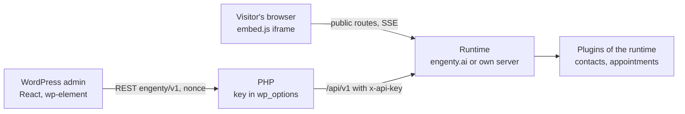

# Plan: the WordPress plugin

Status: concept, written on 2026-10-08. Nothing built. Mockups (eight screens, WordPress admin
with the studio look inside, German UI): https://claude.ai/artifact/8u9iU2ABq2oPo93w1o11Ti

Scope: a WordPress plugin that puts published wizards on a WordPress site (block, shortcode,
Elementor widget, PHP, a bubble on every page), lists the wizards and their results in the
WordPress admin, and shows what the Pro plugins collected there (contacts, appointments).
Building wizards stays in the studio.

## Decisions

| Question | Decision | Why |
|---|---|---|
| Can the runner run in PHP on a WordPress host? | No. The plugin is a client of a runtime | The engine is TypeScript: steps, model calls through the gateway, tools, the sandbox, SSE streams, plugins. A PHP port is a second engine. A typical host has PHP only: no Node, no long-lived process, request timeouts under a minute, no SSE |
| Which runtime? | engenty.ai by default (the account's cloud runtime); an own server ([server.md](../content/user/server.md)) as the second way; a local install only for `localhost` | The same three places the share dialog knows today |
| Studio in WordPress? | No. The admin lists, starts, embeds and reads. "Im Studio öffnen" links out | A studio in the admin is a second studio to keep in step |
| Who talks to the runtime? | Visitors: the browser, straight to the runtime through `embed.js` (iframe), as on any website. The admin: PHP, with the API key kept in `wp_options`, never in the browser | Runs need SSE, uploads, camera, Turnstile: the iframe already has them. The key must not leak into pages or the editor |
| Plugins of the runtime in WordPress? | The WordPress plugin ships a page for the plugins a website cares about: `contacts` (leads) and `appointments` (bookings). Each reads the plugin's own HTTP routes with the key. A plugin the WordPress plugin knows nothing about shows nothing | The studio half of a plugin is React built against the studio; it cannot load in the admin. A generic "any plugin's table" needs a descriptor the SDK does not have; two concrete pages are honest and small |
| License and repository | Own public repository, GPLv2 or later | WordPress.org takes only GPL-compatible plugins; the runtime's FSL license is not. Nothing of the runtime is copied: the plugin is PHP plus a small React admin |
| What WordPress stores | Settings, the key, a cached wizard list (transient, 5 minutes). No runs, no answers | Results stay where they are run; the admin reads them live. Less to protect, nothing to delete |

## What exists that the plugin builds on

| Need | Exists today | Where |
|---|---|---|
| Show a wizard on a page | `embed.js`, `data-wizard`, `data-mode="inline" \| "modal"`, `data-label`; the button takes the site's styles | `apps/web/public/embed.js`, [test-and-share.md](../content/user/test-and-share.md#embed-in-a-website) |
| The chat runner, `data-runner="chat"`, `data-mode="popout"` | On the branch `claude/wizards-vs-bot-ui-1044fe` | [runners-and-voice.md](https://github.com/engenty/engenty-wizards/blob/claude/wizards-vs-bot-ui-1044fe/docs/plans/runners-and-voice.md) § D |
| What a visitor's browser calls | `GET /api/public/wizards/:token`, `POST …/runs` (Turnstile, 6 runs an hour per visitor, 50 a day per link), `/api/runs/:id/*` | `apps/runtime/src/routes/runs.ts` |
| A key for a client | `wz_…` API keys: a local install's under Settings → Einbinden, an account's in the Manage-App. Taken as `x-api-key` or a bearer on `/api/v1` and `/api/mcp` | `apps/runtime/src/mcp/auth.ts`, [manage-contract.md](../manage-contract.md#tokens) |
| List the wizards with a key | `GET /api/v1/spaces` → spaces with `wizards: [{ id, title, publishedVersion, shareUrl, shareEnabled }]` | `apps/runtime/src/routes/api.ts` |
| A plugin's routes | `server.registerHttpRoute` below `/api/studio/plugins/<id>` (session only) | [routes.md](../content/dev/plugins/routes.md) |
| Leads, bookings | `contacts` lists people with `q`, `type`, `role`, `wizard`, pages of 50; `appointments` keeps bookings per person | `engenty-wizards-manage/plugins/{contacts,appointments}` |
| Where the plugin shows up in the studio | Settings → Einbinden lists the AI apps and, under "Teilen", the link and the website tag | `apps/web/src/studio/Integrate.tsx` |

## The plugin

Slug `engenty-wizards`, name "engenty wizards", PHP ≥ 8.1, WordPress ≥ 6.5. One repository,
`engenty/wordpress`, released as a zip on GitHub and later through WordPress.org.

### Pages of the admin

Menu "engenty" with the engenty mark, below "Kommentare".

| Page | Shows | Who |
|---|---|---|
| Wizards | The published wizards of the space: engenty, title, version, where it runs (engenty.ai, own server), link on or off, which plugin it needs. Per wizard: Starten (opens the link), Einbetten (shortcode, block hint, PHP line), Im Studio öffnen. "Neu laden" drops the cache | `edit_posts` |
| Ergebnisse | Runs of the space, newest first: wizard, when, status, the page it ran on, the person's e-mail where the wizard asked one. A row opens a drawer: the answers, the outputs with downloads, the share page | `engenty_results` (given to administrators and editors on activation) |
| Kontakte | Only when the runtime has `contacts`: the leads, search, source wizard, CSV export link. A contact opens in the studio | `engenty_results` |
| Termine | Only when the runtime has `appointments`: the next bookings, cancelled ones, per wizard | `engenty_results` |
| Einstellungen | Verbindung (address, key, "Testen", what the key sees: space, plan, plugins), Darstellung (default mode, button label, the bubble on every page and on which pages), Datenschutz (the sentence for the site's privacy statement, with the runtime's address), Zugriff (which roles see results) | `manage_options` |

Before a connection every page shows the connect screen: engenty.ai (sign in there, make a key
under Einbinden → WordPress, paste it) or an own server (address and key).

### Putting a wizard on a page

All five ways render the same tag. The plugin adds `data-source="wordpress"` and the page's
address so a run knows where it came from (`run.origin`, below).

| Way | How | For |
|---|---|---|
| Block `engenty/wizard` | Pick the wizard, the mode (Im Text, Button + Fenster, Chat, Chat-Blase), the button label. The editor shows the real wizard in an iframe | Gutenberg, the site editor |
| Shortcode | `[engenty_wizard id="TOKEN" mode="modal" label="Anfrage starten"]`; also `[engenty_wizard]` with the default of the settings | Classic editor, page builders with a shortcode widget, widgets |
| Elementor widget | "engenty Wizard" in the "Allgemein" group, the block's controls, live in the canvas | Elementor |
| PHP | `engenty_wizard( 'TOKEN', [ 'mode' => 'inline' ] )` echoes the tag | Themes, templates |
| Bubble | Settings: one wizard as a bubble bottom right on every page, or on chosen pages. A chat bubble when the chat runner is on | Support, lead capture |

`id` takes the share token or the wizard's ID (the code the mobile app takes); the plugin
resolves the code through `GET /api/public/codes/:code` once and caches it.

Modes map to `embed.js`: `inline`, `modal`, `chat` (`data-runner="chat"`, from the branch),
`bubble` (new, below).

### What the admin calls

PHP registers `engenty/v1/*` REST routes (nonce, capability) and forwards to the runtime with
`x-api-key`. The browser never sees the key or the runtime's address of the key.

| REST route | Runtime call | Cached |
|---|---|---|
| `GET status` | `GET /api/v1/me` | no |
| `GET wizards` | `GET /api/v1/wizards` | 5 min transient |
| `GET runs?wizard=&page=`, `GET runs/:id` | `GET /api/v1/runs`, `GET /api/v1/runs/:id` | no |
| `GET contacts?q=&page=` | `GET /api/v1/plugins/contacts/?q=…` | no |
| `GET appointments?from=` | `GET /api/v1/plugins/appointments/bookings?from=…` | no |
| `POST settings` | `GET /api/v1/me` to test, then save | — |

## What the runtime needs (open repository)

| Change | Where | Phase |
|---|---|---|
| `GET /api/v1/me` → `{ user, tenant: { id, name, plan }, runtime: { url, kind: "cloud" \| "server" \| "local" }, plugins: [id], scopes }` with a key | `routes/api.ts` | 1 |
| `GET /api/v1/wizards` → the published wizards of the key's space: `{ id, token, code, title, description, avatar, publishedVersion, shareUrl, shareEnabled, runners, plugins }`. `runners` from `PublicWizard.runners` once the branch merges, `["steps"]` before | `routes/api.ts`, reads what `GET /spaces` and `GET /api/public/wizards/:token` read | 1 |
| Scope `runs:read`; `GET /api/v1/runs?wizard=&status=&page=` and `GET /api/v1/runs/:id` → `RunReport` plus the answers and signed download links, as the studio's results page has them | `mcp/scopes.ts`, `routes/api.ts`, `services/runs.ts`; the Manage-App's key page offers the scope | 2 |
| `run.origin`: the page a run was started on, from `embed.js` (`document.referrer` of the frame's parent, sent with `embedded`) | `db/schema.ts`, `routes/runs.ts`, `embed.js`; shown on the space's results too | 2 |
| `data-mode="bubble"`: a round launcher bottom right that opens the modal, or the chat popout with `data-runner="chat"` | `embed.js`; the share dialog's "Website" gets the third mode | 2 |
| `/api/v1/plugins/:id/*` → the plugin's `registerHttpRoute`s with the key's user and role; `403 { code: "plugin" }` when the tenant lacks the plugin | `routes/api.ts`, `routes/plugins.ts` | 3 |
| Settings → Einbinden: "WordPress" under "Teilen", with the key (a local install: made there; an account: a link to the Manage-App's key page) and the plugin's download | `studio/Integrate.tsx`, `lib/i18n.ts` | 1 |
| `apps/docs`: a user page "WordPress" beside "Test and share" | `docs/content/user/wordpress.md` | 1 |

A local install answers only on `localhost`: the connect screen says so and that visitors need
engenty.ai or an own server, as the share dialog does.

## Phases

| Phase | Builds | Done when |
|---|---|---|
| 1 · Connect and embed | PHP skeleton, settings, connect screen, `/me` and `/wizards`, Wizards page, shortcode, block, PHP function, Einbinden entry, docs page | A wizard from engenty.ai runs inside a WordPress page from the block and from a shortcode, on a stock theme and on a host with PHP only |
| 2 · Results and the bubble | `runs:read`, Ergebnisse page with the drawer, `run.origin`, the bubble, Elementor widget | An editor reads a run's answers and downloads its PDF in the admin; the bubble opens the chat runner on every page |
| 3 · Plugins | `/api/v1/plugins/:id`, Kontakte, Termine, Zugriff settings | Leads a wizard collected on the site show under Kontakte without the studio |
| 4 · Listing | WordPress.org submission, readme.txt, screenshots, the release on GitHub, a starter "Website-Anfrage" among the templates | The plugin installs from the WordPress admin's plugin search |

## Open decisions

- The key's scopes: today a key carries the user's role, no scopes. Either `runs:read` is implied
  by the role, or the Manage-App's key page gets checkboxes. Role only is simpler.
- Allowed sites: should a wizard's link say which origins may embed it (the frame refuses
  others)? Not in the plan; the daily limit and Turnstile stand. Worth it once a link is on a
  busy site.
- Results in the WordPress database: none in this plan. A site that wants its own copy needs a
  webhook from the runtime (`on("run.done")` is a plugin hook; a per-key webhook address does not
  exist).
- Consent: a wizard that asks for contact data needs the site's privacy statement to name the
  runtime. The settings give the sentence; whether the first page of the wizard shows a consent
  line is the wizard's own business (see the GDPR note in the roadmap).
- The chat runner and the bubble need the branch `claude/wizards-vs-bot-ui-1044fe` merged;
  phase 1 does not.
